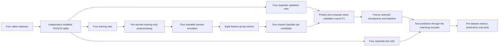

# Mixed-domain neural experiment

For the consolidated procedure, exact results, development trials, fixes and
reproduction caveats, see [Complete process documentation](FULL_PROCESS_DOCUMENTATION.md).

The user authorized dataset-specific encoders on 2026-10-31. This permits a
shared classifier over incompatible native schemas; it does not establish a
common flow representation. TAN-IDS (`journal.pone.0346801.pdf`, sections
4.1–4.5, Tables 5–6) instead uses a shared eight-feature NetFlow representation.

## Inputs and preprocessing

Use the saved seed-42 stratified 70/15/15 memberships without changing labels,
adding synthetic samples, balancing domains or reducing dataset size. Each
domain has its own explicitly recorded numeric feature order and train-fitted
standard scaler. Before scaling apply signed log1p, map Boolean/hex numeric
values to numbers, and replace missing/nonfinite values with zero in transformed
space. This fixed imputation rule is not estimated from validation or test.

DataSense uses network statistics only. Edge uses selected protocol counters,
lengths, flags and ports. X-IIoTID uses connection traffic counters, rates, ports
and Boolean flags. CICIoT2023 uses its supplied numeric traffic statistics.
Raw identities, timestamps, labels, payloads, alert outputs, host logs and scenario
names are not predictors. The precise feature lists, train-only means/scales and
training missing-value counts are saved in `encoded_inputs/*/preprocessing.json`.



## Architectures and shared settings

For each candidate, initialize four trainable feature encoders and one shared
classifier. Each scalar becomes an 8-dimensional token through a per-domain,
per-feature learned affine transform and tanh. Mean-pool these tokens into eight
documented groups: ports, packet counts, size statistics, timing/rates, flags,
protocol attributes, headers/topology, and other attributes. Group assignments
are saved for every feature in the run configuration. Groups organize native
features; they do not assert equivalent flow semantics. Empty groups have zero
latent tokens. Encoder weights are trained jointly with the classifier.

- MLP/DNN: flattened eight-group tokens, hidden widths 128, 64, 32.
- CNN1D: feature-token axis, channels 128, 64, 32, kernel size 3, global pooling.
- LSTM and GRU: two recurrent layers of width 128 followed by a 64/32 head.
- BiLSTM: the corresponding bidirectional recurrent model, combining both final
  hidden states before the shared head.

Recurrent inputs are eight feature-group tokens, **not chronological traffic sequences**.
These are tabular architecture comparisons, not evidence of temporal modelling.
No unrelated shuffled rows are presented as a time series. CNN2D/CNN3D are not
run because a spatial arrangement has not been justified. Reshaping features
alone would not establish one. MLP is already a deep neural network; it is not
counted twice under a different name.

All candidates use Adam, learning rate 0.001, dropout 0.3, unweighted binary
cross-entropy, seed 42, threshold 0.5 and a maximum of 20 epochs. For GPU
throughput, use an effective batch of 8192 and physical batches up to 8192.
Physical microbatches halve automatically on GPU out-of-memory,
preserving the effective batch and per-observation loss weighting. CUDA uses
float16 autocast with gradient scaling and float32 master parameters. Thus the
effective batch differs from the paper's 512 setting.
Every training observation appears once per completed epoch. Domain-homogeneous
batches are randomly interleaved at natural dataset proportions. Early stopping
uses three consecutive epochs without improvement in the validation selection
score. Identical settings do not mean identical architecture parameter counts.
Record counts for each model and its actual epoch/runtime history.

## Selection and evaluation

Choose each checkpoint and the final baseline by unweighted mean macro-F1 over
the four validation sets. Break ties by mean validation average precision, then
fewer trainable parameters. This prevents the largest domain from alone deciding
which checkpoint is selected. Freeze the baseline choice before computing any
model's test scores. Do not tune thresholds or architectures on test results.

For every selected model, evaluate all four test sets separately. Save row
references, probabilities, binary predictions, confusion counts, accuracy,
balanced accuracy, attack precision/recall/F1, macro/weighted F1, MCC,
specificity, false-positive/false-negative rates, ROC-AUC, average precision,
log loss and Brier score. Save confusion matrices, ROC/PR plots and learning
curves. Average precision is the reported PR summary, not trapezoidal PR area.
Undefined single-class ROC-AUC/AP is recorded as null.

Also evaluate a domain-prior reference which predicts each domain's training
attack prevalence without looking at features. It diagnoses performance obtainable
from dataset identity and label imbalance alone and is not a candidate neural
baseline. Domain ID routes encoders and inevitably reveals domain membership.

## Limits

DataSense is window-level, Edge's selected CSV is packet/protocol-level, and the
other exports have their own units. Their observation units remain incompatible.
Scenario-level labels do not establish per-packet attack attribution. Requested
random splits do not isolate duplicates, captures, sessions, devices or nearby
observations. Metrics therefore describe these particular native-record splits,
not independent flow generalization or unseen-domain transfer. This experiment
does not establish adversarial robustness, explanation fidelity or real-time
deployment performance. A baseline is provisional within this adapted setting.

## Reproduction

```powershell
python Coding/edge_ids/prepare_splits.py
python Coding/edge_ids/combine_training.py
python Coding/edge_ids/prepare_features.py
Coding/edge_ids/.venv/Scripts/python.exe Coding/edge_ids/train_adapted.py
Coding/edge_ids/.venv/Scripts/python.exe Coding/edge_ids/verify_results.py
Coding/edge_ids/.venv/Scripts/python.exe Coding/edge_ids/benchmark_inference.py
Coding/edge_ids/.venv/Scripts/python.exe Coding/edge_ids/report.py
```

Use the isolated environment recorded in `requirements-training-lock.txt`.
Checkpoint files are local artifacts; load only trusted local checkpoints.
Development trials in `artifacts/pilot_feature_tokens/` are excluded from the
final comparison; the five final candidates use the corrected grouped encoder.
`last.pt` permits epoch-boundary resumption. `selection.json` marks completed
training for a candidate; `progress.json` records the current stage. Run status
must distinguish prepared code from completed training and final evaluation.

`baseline.py` restores the selected checkpoint and predicts attack probabilities
from the matching domain's preprocessed feature rows. It requires the saved
feature order and training-fitted preprocessing; it is not a raw-packet parser.
All 20 final evaluations passed artifact audits. The loader also reproduced
saved probabilities exactly for 32 observations per domain.

Workstation timing uses five warmups and 20 measured repetitions at batch sizes
1 and 512 on CPU (four threads) and GPU. Timings cover resident preprocessed
inputs, model forward pass and sigmoid only. Extraction, scaling, transfer,
queueing and window collection are excluded. CPU uses float32 and GPU uses
the experiment's mixed precision. These measurements are not end-to-end edge
deployment latency.
