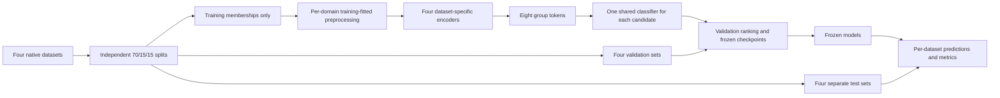

# Complete process documentation

This document preserves the initial five-model phase. The subsequent eleven-model
comparison and current overall baseline are recorded in the
[Extended report](EXTENDED_EXPERIMENT_REPORT.md) and
[Extended methods](EXTENDED_EXPERIMENT_METHOD.md).

Audited: 2026-10-31 (Asia/Seoul client date).

- [1. Scope, completion and evidence](#1-scope-completion-and-evidence)
- [2. Paper consulted and decisions authorized](#2-paper-consulted-and-decisions-authorized)
- [3. Dataset inventory, release selection and labels](#3-dataset-inventory-release-selection-and-labels)
- [4. Exact independent splits](#4-exact-independent-splits)
- [5. Mixed training membership and actual sampling](#5-mixed-training-membership-and-actual-sampling)
- [6. Numerical preprocessing and leakage controls](#6-numerical-preprocessing-and-leakage-controls)
- [7. Feature selection, missingness and exact catalog](#7-feature-selection-missingness-and-exact-catalog)
- [8. Dataset-specific encoders and tensor meaning](#8-dataset-specific-encoders-and-tensor-meaning)
- [9. Exact model architectures](#9-exact-model-architectures)
- [10. Shared training settings and execution](#10-shared-training-settings-and-execution)
- [11. Completed final runs and baseline selection](#11-completed-final-runs-and-baseline-selection)
- [12. Validation results at selected checkpoints](#12-validation-results-at-selected-checkpoints)
- [13. Held-out evaluation protocol and saved predictions](#13-held-out-evaluation-protocol-and-saved-predictions)
- [14. Metric definitions and interpretation](#14-metric-definitions-and-interpretation)
- [15. All final confusion counts and supports](#15-all-final-confusion-counts-and-supports)
- [16. All final class-specific precision, recall and F1](#16-all-final-class-specific-precision-recall-and-f1)
- [17. All final summary, ranking and probability metrics](#17-all-final-summary-ranking-and-probability-metrics)
- [18. Baseline errors and figures](#18-baseline-errors-and-figures)
- [19. Domain-prior reference](#19-domain-prior-reference)
- [20. Workstation inference timing: all measurements](#20-workstation-inference-timing-all-measurements)
- [21. Verification actually performed](#21-verification-actually-performed)
- [22. Development chronology, failures and corrections](#22-development-chronology-failures-and-corrections)
- [23. Environment, tools and files created](#23-environment-tools-and-files-created)
- [24. Module map and data contracts](#24-module-map-and-data-contracts)
- [25. Reproduction and operational cautions](#25-reproduction-and-operational-cautions)
- [26. Limitations, unimplemented stages and defensible conclusions](#26-limitations-unimplemented-stages-and-defensible-conclusions)
- [Appendix A. Complete feature dictionary](#appendix-a-complete-feature-dictionary)
- [Appendix B. Every completed final epoch](#appendix-b-every-completed-final-epoch)
- [Appendix C. Reading order and documentation exports](#appendix-c-reading-order-and-documentation-exports)
- [Appendix D. Complete visual result index](#appendix-d-complete-visual-result-index)

## 1. Scope, completion and evidence

This records the current four-dataset experiment and its development, audited on
2026-10-31 using the user's Asia/Seoul client date. The project was rebuilt after
the earlier reset request; removed earlier experiments are not evidence for this run.

Completed: native-record binary labels, independent stratified splits, mixed
training membership, dataset-specific numerical preprocessing, five final neural
models, validation-only baseline selection, 20 separate model/test evaluations,
80 warm workstation inference timing configurations, saved predictions, plots,
checkpoints and verification. Original dataset files and papers were preserved.

This is an **authorized adapted mixed-domain classification study**, not a
completed real-time, explainable, adversarially robust edge IDS, and not a faithful
reproduction of the paper's common-flow experiment. No PCAP-to-flow extraction
was performed for these final results.

Evidence comes from the current source files and saved JSON/CSV/NPZ/NPY/PT
artifacts. Development events also use the conversation record. No complete
timestamped terminal transcript or versioned historical source tree was saved;
the chronology below is a reconstruction, not an invented command-by-command log.

## 2. Paper consulted and decisions authorized

The local [TAN-IDS paper](../../journal.pone.0346801.pdf), particularly sections
4.1-4.5 and Tables 5-6, was consulted. Its mixed-domain scenario trains on
compatible NetFlow features at natural dataset proportions and tests each domain
separately. Its eight attributes are flow duration, total packets, total bytes,
source port, destination port, protocol, TCP flags and packet rate.

Reference: Dung Ha Thanh (2026), *A transfer-aware, deployment-oriented evaluation
framework for NetFlow-based intrusion detection systems (TAN-IDS)*, PLOS One
21(4): e0346801. [DOI](https://doi.org/10.1371/journal.pone.0346801).

The paper's source datasets are UNSW-NB15 and NF-CSE-CIC-IDS2018, not the four
datasets here. Its mapping cannot reconstruct flows from device-window summaries.
Deterministically encoding a connection state also does not establish equivalence
to a TCP packet-flag bitmask. The proposed exact four-dataset flow representation
was therefore not claimed to exist.

Decision sequence: inspect the paper and local schemas; explain the flow/window
mismatch; prepare independent native-record splits with pooling initially deferred
at the user's request; combine training membership when requested; then obtain
explicit authorization for dataset-specific encoders feeding a shared classifier.
The final training follows that last authorization. The eight encoder groups are
**not** the paper's eight flow attributes.

Retained principles: binary labels, 70/15/15 stratification, natural training
proportions, training-only preprocessing statistics, separate test sets and saved
artifacts. Adaptations: native observation units, per-domain features/scalers and
encoders, feature-group CNN/recurrent models, effective batch 8192 rather than
the paper's 512, mixed precision, early stopping and mean validation macro-F1
selection. CNN and recurrent candidates are additions to the paper's model set.

## 3. Dataset inventory, release selection and labels

| Dataset | Native observation | Selected CSV sources/members | Rows | Features | Binary label provenance |
| --- | --- | --- | --- | --- | --- |
| DataSense | One-second device/network summaries | 2 | 227191 | 64 | label1 |
| Edge-IIoTset | Selected packet/protocol CSV observations | 1 | 2219201 | 25 | Attack_label |
| CICIoT2023 | Supplied traffic-statistic observations | 309 | 46776700 | 39 | scenario folder; Benign_Final=benign, others=attack |
| X-IIoTID | Supplied connection records | 1 | 820834 | 25 | class3 |

Labels are benign=0 and attack=1. String labels are stripped and lowercased;
unknown labels fail instead of being silently assigned a class.

- DataSense: select only matched `attack_samples_1sec.csv` and
  `benign_samples_1sec.csv` nested inside `all_attack_benign_samples.tar.xz`.
  `label1` supplies benign/attack. Other 1-10 second releases are not concatenated,
  avoiding repeated representations of the same traffic at different resolutions.
  The README explicitly describes time-window features. Raw captures were not
  available in the inspected local release.
- Edge-IIoTset: use only `Selected dataset for ML and DL/DNN-EdgeIIoT-dataset.csv`.
  Map `Attack_label` 0/0.0 to benign and 1/1.0 to attack. The overlapping ML release
  and raw traffic CSVs are excluded from this training population. The 24 local
  PCAPs were found but were not processed into flows for this experiment.
- CICIoT2023: use all 309 supplied CSV files in scenario folders. No PCAP files
  were found; names ending `.pcap.csv` are CSV exports. The inspected schemas lack
  embedded labels and endpoint ports/flow identifiers. `Benign_Final` means
  benign; all other supplied scenario folders mean attack. This is scenario-level
  label provenance, not verified per-flow or per-packet attack attribution. The
  README's general embedded-label description does not match these inspected
  files, so the actual folder-based rule is recorded explicitly. Adding unrelated
  folders later is unsafe: the current code labels every non-Benign_Final folder
  as attack and would need review.
- X-IIoTID: use `X-IIoTID dataset.csv`; map `class3` Normal to benign and Attack to
  attack. `class1` and `class2` are excluded predictors. Network connection fields
  are retained; host resources, logs and alert outputs are not used.

No rows were deduplicated, resampled or removed in this stage. No synthetic or
adversarial rows were added. Native records are not relabelled as common flows.
The native split manifests list ordered file paths, archive members, offsets and
row counts; ordinary CSV sources also record sizes and modification times.

## 4. Exact independent splits

For each dataset, `train_test_split` first reserves 30% using `stratify=y` and
`random_state=42`; a second stratified split divides the holdout equally into
validation and test using the same seed. Integer rounding explains one-row
differences. Every selected record receives exactly one split code: 0=train,
1=validation, 2=test. Splits preserve binary class proportions, not attack-subtype,
device, session or capture proportions.

| Dataset | Split | Rows | Benign | Attack | Attack fraction |
| --- | --- | --- | --- | --- | --- |
| DataSense | train | 159033 | 95760 | 63273 | 0.39786082 |
| DataSense | validation | 34079 | 20520 | 13559 | 0.39786966 |
| DataSense | test | 34079 | 20520 | 13559 | 0.39786966 |
| Edge-IIoTset | train | 1553440 | 1130950 | 422490 | 0.27197059 |
| Edge-IIoTset | validation | 332880 | 242346 | 90534 | 0.27197188 |
| Edge-IIoTset | test | 332881 | 242347 | 90534 | 0.27197106 |
| CICIoT2023 | train | 32743690 | 768734 | 31974956 | 0.97652268 |
| CICIoT2023 | validation | 7016505 | 164728 | 6851777 | 0.97652278 |
| CICIoT2023 | test | 7016505 | 164729 | 6851776 | 0.97652264 |
| X-IIoTID | train | 574583 | 294991 | 279592 | 0.48659985 |
| X-IIoTID | validation | 123125 | 63213 | 59912 | 0.48659492 |
| X-IIoTID | test | 123126 | 63213 | 59913 | 0.48659909 |

Original rows are not copied into multiple feature CSV exports. NPZ sidecars
store binary labels and split assignments in source order. JSON stores offsets
and SHA-256 digests of the label and split arrays. Array digests are not hashes
of all original data files, and source-row uniqueness does not prove that record
contents are duplicate-free.

## 5. Mixed training membership and actual sampling

| Dataset | Domain ID | Training rows | Benign | Attack | Percent of mixture |
| --- | --- | --- | --- | --- | --- |
| DataSense | 0 | 159033 | 95760 | 63273 | 0.4539812 |
| Edge-IIoTset | 1 | 1553440 | 1130950 | 422490 | 4.4345045 |
| CICIoT2023 | 2 | 32743690 | 768734 | 31974956 | 93.471289 |
| X-IIoTID | 3 | 574583 | 294991 | 279592 | 1.6402248 |

The mixed index contains **35,030,746** training records:
2,290,435 benign and 32,740,311 attack. No validation or
test rows are included. CICIoT2023 contributes about 93.47% of training rows.

`combine_training.py` concatenates structured entries with `dataset_id:uint8`,
`source_row:uint32` and `label:uint8`, then shuffles using NumPy RNG seed 42.
`source_row` is zero-based within the dataset's ordered source records, excluding
CSV headers. Use source offsets to locate a particular file/member and local row.
The source-backed index preserves provenance; it is not a shared feature matrix.

**The trainer does not stream the saved mixed index directly.** It reconstructs
the same training memberships from each domain's split arrays, shuffles each
domain's training indices with NumPy RNG seed `42 + epoch` (epoch is zero-based),
makes domain-homogeneous batches, and randomly interleaves those batches. Every
training observation appears once per completed epoch. Thus the saved global
index order is not the SGD order. Natural proportions refer to record inclusion;
batch-mean optimizer steps, including a few partial final batches per domain, are
not mathematically identical to globally IID mixed batches or exact uniform
per-record optimizer weighting. No class weights or domain balancing are applied.


## 6. Numerical preprocessing and leakage controls

`prepare_features.py` streams ordinary CSVs in chunks of 100,000 rows. DataSense
is read through nested streaming XZ tar archives and converted in blocks up to
50,000 rows; it is not unpacked into a second complete dataset. CICIoT2023 numeric
CSV parsing uses float32 directly for speed. Other native fields use string
conversion where required.

Processing order for every selected feature:

1. Convert Boolean text TRUE/FALSE to 1/0 where applicable; parse numeric hex
   strings such as TCP flag values; coerce other numeric text to float32.
2. Treat unparseable values and nonfinite numeric values as missing (malformed hex
   parsing can fail rather than being silently accepted).
3. Apply the fixed transform `z = sign(x) * log(1 + abs(x))`.
4. Replace missing transformed values by zero. This is fixed imputation, not a
   fitted mean/median policy. Missingness indicators are not added. Imputation
   can therefore conflate missing information with a true transformed zero.
5. For each domain independently, fit `StandardScaler.partial_fit` only on its
   training rows after fixed imputation. Fit means/scales over the complete
   training population, not a pilot sample.
6. Apply that same fitted transformation to all rows, including validation and
   test, without refitting; save standardized float32 arrays using memory maps.
   No clipping is implemented. Constant-feature scaling follows StandardScaler.

The standardized feature is `(z - training_mean) / training_scale`. Exact means,
scales, missing counts, feature names/order and split/label digests are saved in
each `preprocessing.json`. The appendix table is rounded for readability; JSON
and the feature catalog CSV retain Python's saved numeric precision.

Labels, scenario names, timestamps and raw identities are excluded as predictors.
DataSense derived distinct-IP/MAC/port/protocol counts **are retained**; exclusion
of raw identities does not eliminate all possible identity/scenario shortcuts.
X-IIoTID Protocol, Service and Conn_state categories are not encoded: they are
excluded from the explicit 25-field input. No cross-domain protocol dictionary,
byte-unit harmonization or eight-feature NetFlow conversion was performed.

During this documentation audit, the broad `excluded` descriptions in the four
preprocessing manifests were clarified to match the explicit feature lists. In
particular, an older DataSense description incorrectly suggested identity counts
were excluded. Only this descriptive text changed; feature arrays, feature
selection/order, labels, splits, means, scales and checkpoints were preserved.
See [description corrections](artifacts/documentation/metadata_description_corrections.json).

## 7. Feature selection, missingness and exact catalog

| Dataset | Selected features | Training missing cells | Numeric feature matrix |
| --- | --- | --- | --- |
| DataSense | 64 | 0 | 227,191 x 64 |
| Edge-IIoTset | 25 | 1584 | 2,219,201 x 25 |
| CICIoT2023 | 39 | 1745 | 46,776,700 x 39 |
| X-IIoTID | 25 | 1902711 | 820,834 x 25 |

DataSense retains numeric `network_` fields while excluding raw identity/port/
protocol lists and all sensor/log fields. Edge and X-IIoTID use fixed explicit
column lists selected by source schema and field type, not a fitted feature
selection algorithm. CICIoT2023 uses the supplied 39 numeric fields. No SHAP,
permutation importance, statistical ranking or target-test-based feature selection
was performed. The grouping/selection is engineering judgment, not a validated
semantic equivalence test. Missing-cell totals are counts across selected training
features, not numbers of missing rows.

[Complete feature catalog](artifacts/documentation/feature_catalog.csv) contains
all 153 domain-specific fields, exact order, encoder group, training missing
count/fraction and recorded scaling mean/scale. Appendix A reproduces the list.
This is a column inventory, not a verified physical-unit dictionary. Per-feature
units, traffic direction and extraction semantics were not comprehensively
validated or reconciled across the four native exporters.

## 8. Dataset-specific encoders and tensor meaning

Each candidate has four separate trainable encoders and one shared classifier.
Domain identity is supplied to route a row to the correct encoder; it is not
inferred from traffic. This is known-domain mixed training, not zero-shot transfer
to a new dataset. An unknown schema has no trained encoder.

For feature j in domain d, create an 8-dimensional token:
`t[d,j] = tanh(x[d,j] * W[d,j] + b[d,j])`, with learned 8-vectors W and b.
W and b initialize from normal noise scaled by 0.02. Mean-pool tokens within each
saved group to obtain shape `[batch, 8 groups, 8 embedding components]`. Empty
groups produce zero latent tokens; those zeros are not observed network counts.
Pooling masks are registered model buffers and saved with checkpoints. The
encoders and shared classifier are optimized jointly; each domain batch updates
its encoder and the shared classifier.

Group order: ports, packet_counts, size_statistics, timing_rates, flags,
protocol_attributes, headers_topology, other. `group_for()` uses deterministic
name heuristics with priority rules. Group names organize native attributes,
not common physical definitions. One saved example is `tcp.connection.synack`
in `other`, because the final boundary-matching rule does not recognize the
combined SYNACK token. The recorded assignment is reported, not silently changed
after training. These heuristics have not undergone a comprehensive semantic
ontology audit.

MLP flattens the 8 x 8 representation to 64 values. CNN1D treats the eight groups
as its feature axis and the eight embedding components as channels. LSTM/GRU/
BiLSTM process the fixed feature-group order, not chronological observations.
This does not test temporal traffic learning. No adjacent shuffled rows are
fabricated into a time series. No 2-D/3-D models were run because meaningful
spatial axes were unavailable. Repacking a vector alone would not establish them.



## 9. Exact model architectures

All candidates output one attack logit and use sigmoid for probabilities. Dropout
is disabled for evaluation. MLP and DNN name the same candidate, not two runs.

| Candidate | Shared backbone after the domain encoder | Shared output head |
|---|---|---|
| MLP | Flatten 8x8; Linear 64->128; ReLU; Dropout 0.3 | Linear 128->64, ReLU, Dropout; Linear 64->32, ReLU, Dropout; Linear 32->1 |
| CNN1D | Conv1d 8->128, k=3,pad=1,ReLU,Dropout; Conv1d 128->64,k=3,pad=1,ReLU,Dropout; Conv1d 64->32,k=3,pad=1,ReLU; adaptive average pool to 1; flatten | Linear 32->64, ReLU, Dropout; Linear 64->32, ReLU, Dropout; Linear 32->1 |
| LSTM | Input width 8, hidden width 128, two layers, batch_first, recurrent dropout 0.3; final top-layer hidden state | Linear 128->64, ReLU, Dropout; Linear 64->32, ReLU, Dropout; Linear 32->1 |
| GRU | Same dimensions/layers as LSTM, using GRU cells | Same 128->64->32->1 head |
| BiLSTM | Two-layer bidirectional LSTM, hidden width 128 per direction; concatenate final forward/backward hidden states (256 values) | Linear 256->64, ReLU, Dropout; Linear 64->32, ReLU, Dropout; Linear 32->1 |

Head dropout is 0.3. ReLU and dropout are applied after the intermediate head
layers as shown. Recurrent cell nonlinearities follow the PyTorch cell definition.
Model-specific cell/conv parameters and parameter counts differ; 'same parameters'
means common comparable training settings, not mathematically identical models.

## 10. Shared training settings and execution

| Setting | Value |
| --- | --- |
| Seed | 42 |
| Optimizer | Adam |
| Learning rate | 0.001 |
| Adam betas | [0.9, 0.999] |
| Adam epsilon | 1e-08 |
| Weight decay | 0 |
| Dropout | 0.3 |
| Loss | Unweighted BCEWithLogitsLoss |
| Effective batch | 8192 |
| Initial physical microbatch | 8192 |
| Maximum epochs | 20 |
| Early-stopping patience | 3 |
| Probability threshold | 0.5 |
| CUDA precision | float16 autocast; GradScaler; float32 master weights |
| Torch CPU threads | 4 |
| cuDNN deterministic | True |
| cuDNN benchmark | False |

Python, NumPy and Torch RNGs are seeded for each candidate; CUDA RNGs are seeded
where available. No learning-rate scheduler, explicit gradient clipping, class
weighting, focal loss or data augmentation is implemented. Other Adam options
use the captured installed defaults in the environment JSON. Reproducibility
across different devices/library versions is not claimed to be bit-for-bit.

For a batch, clear gradients, forward the native rows through their domain encoder
and shared model, compute BCE, scale gradients, backpropagate and step Adam. When
microbatches are needed, each micro-loss is weighted by its share of the batch.
If CUDA runs out of memory, physical microbatch size halves and the batch is
retried with cleared gradients; the effective batch remains unchanged. This
fallback exists in code; it is not claimed to have been needed in the final run.
Nonfinite batch loss raises an error. Progress is periodically persisted.

Every epoch ends with predictions on each validation set. History records training
BCE, per-domain validation macro-F1/AP, mean scores, rows processed and an epoch
timer. Timer capture occurs before final history/checkpoint/plot writes and does
not include environment installation, initial feature preparation, development
trials, model initialization or full end-to-end project wall time.

## 11. Completed final runs and baseline selection

| Model | Trainable parameters | Epochs run | Selected epoch | Sum epoch timers (s) | Best mean validation macro-F1 | Associated mean validation AP |
| --- | --- | --- | --- | --- | --- | --- |
| MLP | 21137 | 20 | 19 | 333.11797 | 0.94336292 | 0.97644702 |
| CNN1D | 40689 | 20 | 20 | 700.25422 | 0.94222059 | 0.9757397 |
| LSTM | 215569 | 14 | 11 | 686.3358 | 0.9336052 | 0.9730162 |
| GRU | 164881 | 11 | 8 | 551.23536 | 0.93278919 | 0.97244409 |
| BiLSTM | 557585 | 9 | 6 | 888.16126 | 0.92643375 | 0.96975216 |

Total final recorded epochs: **74**. Total native training-record
presentations over those epochs: **2,592,275,204**.
This is repeated exposure to the same training population, not additional unique
data. Early-stopped models retain the best checkpoint, not their last checkpoint.

After each epoch, compute the unweighted mean of the four validation macro-F1
values. Improve a candidate checkpoint when `(mean macro-F1, mean AP)` improves
lexicographically. Three consecutive non-improvements trigger early stopping.
Choose the final candidate by mean validation macro-F1, then mean validation AP,
then fewer trainable parameters. Threshold remains 0.5 and is not optimized on
test data. No test metric determines the baseline.

Selected baseline: **MLP**, checkpoint epoch
**19**, validation mean
macro-F1 **0.94336292**. It is the best
of the five final grouped-encoder candidates for this seed and rule, not a claim
of universal superiority or the best result among every discarded pilot.
The small lead over CNN1D has not been tested for statistical significance.

[Baseline selection record](artifacts/adapted_experiment/baseline.json).
[All recorded epochs](artifacts/documentation/training_history.csv).
Appendix B lists every final epoch's aggregate scores and runtime.

## 12. Validation results at selected checkpoints

| Model | Checkpoint epoch | Validation dataset | Macro-F1 | Average precision |
| --- | --- | --- | --- | --- |
| MLP | 19 | DataSense | 0.89179476 | 0.91186288 |
| MLP | 19 | Edge-IIoTset | 0.99472287 | 0.99759088 |
| MLP | 19 | CICIoT2023 | 0.9138379 | 0.99994702 |
| MLP | 19 | X-IIoTID | 0.97309614 | 0.99638729 |
| CNN1D | 20 | DataSense | 0.8861519 | 0.90887474 |
| CNN1D | 20 | Edge-IIoTset | 0.9946946 | 0.99762679 |
| CNN1D | 20 | CICIoT2023 | 0.91578434 | 0.99994796 |
| CNN1D | 20 | X-IIoTID | 0.97225153 | 0.9965093 |
| LSTM | 11 | DataSense | 0.8750797 | 0.90299833 |
| LSTM | 11 | Edge-IIoTset | 0.99477059 | 0.99763542 |
| LSTM | 11 | CICIoT2023 | 0.90598402 | 0.9999422 |
| LSTM | 11 | X-IIoTID | 0.95858651 | 0.99148884 |
| GRU | 8 | DataSense | 0.87839635 | 0.90353378 |
| GRU | 8 | Edge-IIoTset | 0.9945917 | 0.99764547 |
| GRU | 8 | CICIoT2023 | 0.91192927 | 0.99994427 |
| GRU | 8 | X-IIoTID | 0.94623946 | 0.98865284 |
| BiLSTM | 6 | DataSense | 0.88188724 | 0.9039124 |
| BiLSTM | 6 | Edge-IIoTset | 0.99522084 | 0.99711466 |
| BiLSTM | 6 | CICIoT2023 | 0.90975284 | 0.99994166 |
| BiLSTM | 6 | X-IIoTID | 0.91887408 | 0.9780399 |

## 13. Held-out evaluation protocol and saved predictions

The baseline decision was written before any final model's test results were
computed. Each candidate's best checkpoint is restored and evaluated on all four
test sets separately, producing 5 x 4 = 20 evaluations. Rows are processed in
their saved native test order, in inference batches up to 8192. GPU inference
uses autocast; logits are converted to float32 before sigmoid.

For each model/domain, save `predictions.npz` with `labels`, `probability` and
`predicted`; `source_rows.npy` identifies original native test rows; `metrics.json`
stores scalar results; `confusion_matrix.png` and `roc_pr.png` provide plots.
The report supplements benign-class metrics and renders confusion counts plus
row-normalized matrices from the saved counts. ROC has a diagonal reference;
PR has a test-prevalence reference. Learning curves show training loss and mean
validation macro-F1. A separate all-model plot compares test macro-F1 by domain.

No adversarial samples or test-time adaptation are involved. This is within-known-
domain held-out testing after training on all four domains, not source-only
cross-domain transfer. Tests remain separate even though validation ranking
averages the four domains.

## 14. Metric definitions and interpretation

Positive class is attack=1. Confusion rows are actual [benign,attack], columns are
predicted [benign,attack], so the matrix is `[[TN,FP],[FN,TP]]`.

| Metric | Definition/implementation |
|---|---|
| Accuracy | (TP+TN)/N |
| Attack precision | TP/(TP+FP) |
| Attack recall / detection rate | TP/(TP+FN) |
| Attack F1 | 2TP/(2TP+FP+FN) |
| Benign precision | TN/(TN+FN) |
| Benign recall / specificity | TN/(TN+FP) |
| Benign F1 | 2TN/(2TN+FP+FN) |
| Macro-F1 | Mean of benign F1 and attack F1 |
| Weighted F1 | Class F1 weighted by actual class supports |
| Balanced accuracy | Mean of the two class recalls |
| False-positive rate | FP/(TN+FP), the benign false-alarm fraction |
| False-negative rate | FN/(TP+FN), the attack miss fraction |
| MCC | sklearn Matthews correlation coefficient |
| ROC-AUC | sklearn roc_auc_score on attack probabilities |
| Average precision (AP) | sklearn average_precision_score; not trapezoidal PR area |
| Log loss | sklearn binary log_loss; probability clipping follows installed sklearn precision |
| Brier score | Mean squared difference between probability and binary label |
| Support | Number of actual records of each class |

Precision/recall/F1 use zero_division=0. Undefined single-class ROC-AUC/AP are
recorded as null; both classes occur in the actual selected test sets. Rate
denominators absent in generic evaluation return null where implemented.
High accuracy/AP on a heavily attack-dominated domain does not describe its
benign false-alarm performance. Read the per-class rates and supports as well.
There are no confidence intervals, bootstrap tests, multi-seed averages, calibrated
probability claims or significance tests in this run.

## 15. All final confusion counts and supports

| Model | Test dataset | N | TN | FP | FN | TP | Benign support | Attack support |
| --- | --- | --- | --- | --- | --- | --- | --- | --- |
| MLP | DataSense | 34079 | 20219 | 301 | 3147 | 10412 | 20520 | 13559 |
| MLP | Edge-IIoTset | 332881 | 241400 | 947 | 401 | 90133 | 242347 | 90534 |
| MLP | CICIoT2023 | 7016505 | 139472 | 25257 | 31346 | 6820430 | 164729 | 6851776 |
| MLP | X-IIoTID | 123126 | 61984 | 1229 | 2045 | 57868 | 63213 | 59913 |
| CNN1D | DataSense | 34079 | 20335 | 185 | 3385 | 10174 | 20520 | 13559 |
| CNN1D | Edge-IIoTset | 332881 | 241456 | 891 | 435 | 90099 | 242347 | 90534 |
| CNN1D | CICIoT2023 | 7016505 | 145217 | 19512 | 37654 | 6814122 | 164729 | 6851776 |
| CNN1D | X-IIoTID | 123126 | 61973 | 1240 | 2014 | 57899 | 63213 | 59913 |
| LSTM | DataSense | 34079 | 20312 | 208 | 3677 | 9882 | 20520 | 13559 |
| LSTM | Edge-IIoTset | 332881 | 241460 | 887 | 419 | 90115 | 242347 | 90534 |
| LSTM | CICIoT2023 | 7016505 | 133844 | 30885 | 29419 | 6822357 | 164729 | 6851776 |
| LSTM | X-IIoTID | 123126 | 61577 | 1636 | 3386 | 56527 | 63213 | 59913 |
| GRU | DataSense | 34079 | 20398 | 122 | 3641 | 9918 | 20520 | 13559 |
| GRU | Edge-IIoTset | 332881 | 241463 | 884 | 479 | 90055 | 242347 | 90534 |
| GRU | CICIoT2023 | 7016505 | 142273 | 22456 | 36457 | 6815319 | 164729 | 6851776 |
| GRU | X-IIoTID | 123126 | 61394 | 1819 | 4648 | 55265 | 63213 | 59913 |
| BiLSTM | DataSense | 34079 | 19899 | 621 | 3163 | 10396 | 20520 | 13559 |
| BiLSTM | Edge-IIoTset | 332881 | 241406 | 941 | 272 | 90262 | 242347 | 90534 |
| BiLSTM | CICIoT2023 | 7016505 | 141699 | 23030 | 37481 | 6814295 | 164729 | 6851776 |
| BiLSTM | X-IIoTID | 123126 | 57094 | 6119 | 3870 | 56043 | 63213 | 59913 |

## 16. All final class-specific precision, recall and F1

| Model | Dataset | Benign precision | Benign recall | Benign F1 | Attack precision | Attack recall | Attack F1 | Macro-F1 | Weighted F1 |
| --- | --- | --- | --- | --- | --- | --- | --- | --- | --- |
| MLP | DataSense | 0.86531713 | 0.98533138 | 0.9214328 | 0.9719033 | 0.76790324 | 0.85794331 | 0.88968806 | 0.89617226 |
| MLP | Edge-IIoTset | 0.99834161 | 0.99609238 | 0.99721573 | 0.98960255 | 0.99557072 | 0.99257766 | 0.9948967 | 0.99595431 |
| MLP | CICIoT2023 | 0.81649475 | 0.84667545 | 0.83131126 | 0.99631052 | 0.99542513 | 0.99586763 | 0.91358945 | 0.99200428 |
| MLP | X-IIoTID | 0.96806135 | 0.9805578 | 0.9742695 | 0.97920368 | 0.96586717 | 0.97248971 | 0.9733796 | 0.97340346 |
| CNN1D | DataSense | 0.85729342 | 0.99098441 | 0.9193038 | 0.98214113 | 0.75035032 | 0.85074003 | 0.88502191 | 0.89202435 |
| CNN1D | Edge-IIoTset | 0.99820167 | 0.99632345 | 0.99726168 | 0.99020772 | 0.99519518 | 0.99269518 | 0.99497843 | 0.99601972 |
| CNN1D | CICIoT2023 | 0.79409529 | 0.88155091 | 0.83554085 | 0.99714471 | 0.99450449 | 0.99582285 | 0.91568185 | 0.99205985 |
| CNN1D | X-IIoTID | 0.96852486 | 0.98038378 | 0.97441824 | 0.97903245 | 0.96638459 | 0.97266741 | 0.97354282 | 0.97356629 |
| LSTM | DataSense | 0.84672141 | 0.98986355 | 0.91271428 | 0.97938553 | 0.72881481 | 0.83572244 | 0.87421836 | 0.88208156 |
| LSTM | Edge-IIoTset | 0.99826773 | 0.99633996 | 0.99730291 | 0.99025296 | 0.9953719 | 0.99280583 | 0.99505437 | 0.99607984 |
| LSTM | CICIoT2023 | 0.81980608 | 0.81251024 | 0.81614186 | 0.99549337 | 0.99570637 | 0.99559986 | 0.90587086 | 0.99138666 |
| LSTM | X-IIoTID | 0.94787802 | 0.97411925 | 0.9608195 | 0.97187215 | 0.94348472 | 0.95746807 | 0.95914378 | 0.9591887 |
| GRU | DataSense | 0.84853779 | 0.99405458 | 0.91555017 | 0.98784861 | 0.73146987 | 0.84054409 | 0.87804713 | 0.88570753 |
| GRU | Edge-IIoTset | 0.99802019 | 0.99635234 | 0.99718556 | 0.9902792 | 0.99470917 | 0.99248924 | 0.9948374 | 0.9959083 |
| GRU | CICIoT2023 | 0.79602193 | 0.86367913 | 0.82847152 | 0.99671589 | 0.99467919 | 0.9956965 | 0.91208401 | 0.9917705 |
| GRU | X-IIoTID | 0.92962054 | 0.97122427 | 0.94996712 | 0.96813468 | 0.92242084 | 0.94472508 | 0.9473461 | 0.94741635 |
| BiLSTM | DataSense | 0.86284798 | 0.96973684 | 0.91317516 | 0.94363257 | 0.76672321 | 0.84602865 | 0.8796019 | 0.8864596 |
| BiLSTM | Edge-IIoTset | 0.99887454 | 0.99611714 | 0.99749393 | 0.98968236 | 0.9969956 | 0.99332552 | 0.99540973 | 0.99636024 |
| BiLSTM | CICIoT2023 | 0.79081929 | 0.86019462 | 0.82404939 | 0.99663172 | 0.99452974 | 0.99557962 | 0.9098145 | 0.99155255 |
| BiLSTM | X-IIoTID | 0.93651991 | 0.90320029 | 0.91955837 | 0.90156366 | 0.93540634 | 0.91817325 | 0.91886581 | 0.91888438 |

## 17. All final summary, ranking and probability metrics

| Model | Dataset | Accuracy | Balanced accuracy | MCC | Specificity | FPR | FNR | ROC-AUC | AP | Log loss | Brier |
| --- | --- | --- | --- | --- | --- | --- | --- | --- | --- | --- | --- |
| MLP | DataSense | 0.89882332 | 0.87661731 | 0.79411801 | 0.98533138 | 0.014668616 | 0.23209676 | 0.9099026 | 0.90877532 | 0.27960378 | 0.083445989 |
| MLP | Edge-IIoTset | 0.9959505 | 0.99583155 | 0.98980189 | 0.99609238 | 0.0039076201 | 0.0044292752 | 0.99955124 | 0.99771816 | 0.015410261 | 0.0037206556 |
| MLP | CICIoT2023 | 0.99193288 | 0.92105029 | 0.82732327 | 0.84667545 | 0.15332455 | 0.0045748723 | 0.99777943 | 0.9999469 | 0.017998047 | 0.0057544084 |
| MLP | X-IIoTID | 0.97340935 | 0.97321249 | 0.94684491 | 0.9805578 | 0.019442203 | 0.034132826 | 0.99634934 | 0.99647723 | 0.075213976 | 0.020759463 |
| CNN1D | DataSense | 0.89524341 | 0.87066736 | 0.7888612 | 0.99098441 | 0.0090155945 | 0.24964968 | 0.90676147 | 0.90673612 | 0.28341883 | 0.084853478 |
| CNN1D | Edge-IIoTset | 0.99601659 | 0.99575931 | 0.98996279 | 0.99632345 | 0.0036765464 | 0.0048048247 | 0.99957072 | 0.9977858 | 0.013347831 | 0.003306278 |
| CNN1D | CICIoT2023 | 0.99185264 | 0.9380277 | 0.83256836 | 0.88155091 | 0.11844909 | 0.0054955095 | 0.99781681 | 0.9999478 | 0.017988676 | 0.0057598092 |
| CNN1D | X-IIoTID | 0.97357179 | 0.97338419 | 0.94716276 | 0.98038378 | 0.019616218 | 0.033615409 | 0.99657584 | 0.99658846 | 0.076039687 | 0.021638241 |
| LSTM | DataSense | 0.88600018 | 0.85933918 | 0.77052267 | 0.98986355 | 0.010136452 | 0.27118519 | 0.89661531 | 0.90128812 | 0.30178675 | 0.090940669 |
| LSTM | Edge-IIoTset | 0.99607668 | 0.99585593 | 0.99011499 | 0.99633996 | 0.0036600412 | 0.0046280955 | 0.99945959 | 0.99769019 | 0.013610058 | 0.0032705907 |
| LSTM | CICIoT2023 | 0.99140541 | 0.90410831 | 0.81175031 | 0.81251024 | 0.18748976 | 0.0042936313 | 0.99757506 | 0.99994201 | 0.018720899 | 0.0060291463 |
| LSTM | X-IIoTID | 0.95921251 | 0.95880198 | 0.91867644 | 0.97411925 | 0.025880752 | 0.05651528 | 0.99118076 | 0.99180682 | 0.11281064 | 0.032088667 |
| GRU | DataSense | 0.88958009 | 0.86276223 | 0.77898574 | 0.99405458 | 0.0059454191 | 0.26853013 | 0.89881511 | 0.89995676 | 0.30209401 | 0.090569548 |
| GRU | Edge-IIoTset | 0.99590544 | 0.99553075 | 0.98967948 | 0.99635234 | 0.0036476622 | 0.00529083 | 0.99957676 | 0.99780633 | 0.013885963 | 0.0033772751 |
| GRU | CICIoT2023 | 0.99160365 | 0.92917916 | 0.82489582 | 0.86367913 | 0.13632087 | 0.0053208103 | 0.99766109 | 0.99994408 | 0.018370094 | 0.0059061758 |
| GRU | X-IIoTID | 0.94747657 | 0.94682256 | 0.89569781 | 0.97122427 | 0.028775727 | 0.077579156 | 0.98882808 | 0.98902444 | 0.1316976 | 0.038702395 |
| BiLSTM | DataSense | 0.88896388 | 0.86823003 | 0.77067548 | 0.96973684 | 0.030263158 | 0.23327679 | 0.89488539 | 0.90106751 | 0.30225763 | 0.090301231 |
| BiLSTM | Edge-IIoTset | 0.99635606 | 0.99655637 | 0.9908322 | 0.99611714 | 0.0038828622 | 0.0030043961 | 0.99940865 | 0.99728403 | 0.015259007 | 0.0033464937 |
| BiLSTM | CICIoT2023 | 0.99137591 | 0.92736218 | 0.82039842 | 0.86019462 | 0.13980538 | 0.0054702606 | 0.99755649 | 0.99994157 | 0.018843096 | 0.0060585462 |
| BiLSTM | X-IIoTID | 0.91887172 | 0.91930332 | 0.83834506 | 0.90320029 | 0.096799709 | 0.064593661 | 0.9767537 | 0.97832924 | 0.19595625 | 0.05867824 |

[Machine-readable full metric table](artifacts/report/test_metrics.csv).


## 18. Baseline errors and figures

The selected MLP misses **23.21%**
of DataSense attacks and falsely flags **15.33%**
of CICIoT2023 benign test observations. These are substantial remaining errors,
despite high aggregate accuracy in some domains. The label provenance and split
limitations below must also constrain interpretation.

The frozen threshold is not retuned after observing these errors. This is a
provisional experimental baseline, not a certified deployment-ready IDS.

### DataSense


### Edge-IIoTset


### CICIoT2023


### X-IIoTID


## 19. Domain-prior reference

For each domain, predict its training attack prevalence for every test row,
without inspecting any traffic features. Use the same threshold 0.5. This
reference uses domain identity and training labels only. It is not a neural
candidate or part of baseline selection. It makes the benefit of class imbalance
and known-domain routing visible.

| Dataset | Training attack prior | Test accuracy | Macro-F1 | ROC-AUC | AP |
| --- | --- | --- | --- | --- | --- |
| DataSense | 0.39786082 | 0.60213034 | 0.37583106 | 0.5 | 0.39786966 |
| Edge-IIoTset | 0.27197059 | 0.72802894 | 0.42130599 | 0.5 | 0.27197106 |
| CICIoT2023 | 0.97652268 | 0.97652264 | 0.49406094 | 0.5 | 0.97652264 |
| X-IIoTID | 0.48659985 | 0.51340091 | 0.33923655 | 0.5 | 0.48659909 |

[Reference metrics](artifacts/report/domain_prior_metrics.csv). No paired
significance analysis against the neural candidates was performed.

## 20. Workstation inference timing: all measurements

Use the first 512 training records of each domain as timing inputs, not additional
test-label tuning. Restore each model's best checkpoint. Measure CPU (four Torch
threads, float32) and GPU (autocast) at batch sizes 1 and 512. Inputs are already
preprocessed and resident on the measured device before timing. Each case uses
five warmups and 20 timed repetitions. CUDA is synchronized before and after each
timed forward pass. Time the model plus sigmoid, then report median, p95 and
batch_size/median_seconds throughput. Twenty repetitions give an empirical p95,
not a tail-latency guarantee. Raw repetition-level durations were not saved, so
the reported medians/p95 cannot be independently reconstructed from the CSV alone.

This is warm, cached-input **workstation model inference**, not edge-device or
end-to-end latency. Excluded: PCAP/packet extraction, CSV parsing, feature/window
construction, imputation/scaling, host-to-device transfer, queueing, SHAP/IG and
window collection. DataSense's one-second observation window is not included
in these millisecond model timings. No live deployment or throughput stress test
was performed. CPU/GPU precision differs as disclosed; timings are not a pure
hardware-only comparison.

| Model | Dataset | Device | Batch | Repetitions | Median ms | p95 ms | Observations/s |
| --- | --- | --- | --- | --- | --- | --- | --- |
| MLP | DataSense | cpu | 1 | 20 | 0.12699997751042247 | 0.1467700640205294 | 7874.0171423883385 |
| MLP | DataSense | cpu | 512 | 20 | 0.5018999800086021 | 0.5647199810482562 | 1020123.5712167686 |
| MLP | Edge-IIoTset | cpu | 1 | 20 | 0.08500006515532732 | 0.09015498217195272 | 11764.69686432147 |
| MLP | Edge-IIoTset | cpu | 512 | 20 | 0.4059999482706189 | 0.464749924140051 | 1261083.9045199258 |
| MLP | CICIoT2023 | cpu | 1 | 20 | 0.08194998372346163 | 0.09059510193765163 | 12202.564961751274 |
| MLP | CICIoT2023 | cpu | 512 | 20 | 0.49450004007667303 | 0.5734949430916458 | 1035389.1981901833 |
| MLP | X-IIoTID | cpu | 1 | 20 | 0.0809000339359045 | 0.08980498532764615 | 12360.93424623629 |
| MLP | X-IIoTID | cpu | 512 | 20 | 0.3282999387010932 | 0.3408149175811559 | 1559549.4840045033 |
| MLP | DataSense | cuda | 1 | 20 | 0.38285000482574105 | 0.40399504359811544 | 2611.9889967225217 |
| MLP | DataSense | cuda | 512 | 20 | 0.39469997864216566 | 0.5792649870272728 | 1297187.80771503 |
| MLP | Edge-IIoTset | cuda | 1 | 20 | 0.368050008546561 | 0.3895699861459435 | 2717.0220806379707 |
| MLP | Edge-IIoTset | cuda | 512 | 20 | 0.38519996451213956 | 0.4177150316536427 | 1329179.7693918643 |
| MLP | CICIoT2023 | cuda | 1 | 20 | 0.36370003363117576 | 0.3824499959591776 | 2749.5185799572655 |
| MLP | CICIoT2023 | cuda | 512 | 20 | 0.37555000744760036 | 0.41957003995776176 | 1363333.7500903609 |
| MLP | X-IIoTID | cuda | 1 | 20 | 0.35055004991590977 | 0.37669006851501763 | 2852.6596993492963 |
| MLP | X-IIoTID | cuda | 512 | 20 | 0.3772499621845782 | 0.40293503552675247 | 1357190.3282245852 |
| CNN1D | DataSense | cpu | 1 | 20 | 0.15989993698894978 | 0.17671994864940643 | 6253.911157382802 |
| CNN1D | DataSense | cpu | 512 | 20 | 1.721650012768805 | 1.7662999336607754 | 297389.1303126049 |
| CNN1D | Edge-IIoTset | cpu | 1 | 20 | 0.15184999210759997 | 0.1667350996285677 | 6585.44650625603 |
| CNN1D | Edge-IIoTset | cpu | 512 | 20 | 1.5380000113509595 | 1.5933199436403813 | 332899.8675040748 |
| CNN1D | CICIoT2023 | cpu | 1 | 20 | 0.16555003821849823 | 0.1838300027884543 | 6040.469762261052 |
| CNN1D | CICIoT2023 | cpu | 512 | 20 | 1.6290000639855862 | 1.6650449892040342 | 314303.2411842375 |
| CNN1D | X-IIoTID | cpu | 1 | 20 | 0.1641499693505466 | 0.1744349312502891 | 6091.990171892591 |
| CNN1D | X-IIoTID | cpu | 512 | 20 | 1.5617500175721943 | 1.61487995646894 | 327837.3582450317 |
| CNN1D | DataSense | cuda | 1 | 20 | 0.603449996560812 | 0.6392850889824331 | 1657.1381319068846 |
| CNN1D | DataSense | cuda | 512 | 20 | 0.6234500324353576 | 0.6474450347013772 | 821236.6242086719 |
| CNN1D | Edge-IIoTset | cuda | 1 | 20 | 0.6840000860393047 | 0.7447700423654169 | 1461.9881201923372 |
| CNN1D | Edge-IIoTset | cuda | 512 | 20 | 0.6338999373838305 | 0.6685949687380344 | 807698.4549218856 |
| CNN1D | CICIoT2023 | cuda | 1 | 20 | 0.6031999946571887 | 0.6181100441608578 | 1657.8249483710974 |
| CNN1D | CICIoT2023 | cuda | 512 | 20 | 0.6036500562913716 | 0.6417499971576035 | 848173.5314423069 |
| CNN1D | X-IIoTID | cuda | 1 | 20 | 0.6041000597178936 | 0.6246100936550647 | 1655.35491002432 |
| CNN1D | X-IIoTID | cuda | 512 | 20 | 0.6219499628059566 | 0.640899984864518 | 823217.3496563741 |
| LSTM | DataSense | cpu | 1 | 20 | 0.2734999870881438 | 0.29426502878777683 | 3656.307302412117 |
| LSTM | DataSense | cpu | 512 | 20 | 5.066799989435822 | 10.499110055388888 | 101049.97257983539 |
| LSTM | Edge-IIoTset | cpu | 1 | 20 | 0.2989000640809536 | 0.35174996010027837 | 3345.599818035374 |
| LSTM | Edge-IIoTset | cpu | 512 | 20 | 4.929149989038706 | 6.388040067395195 | 103871.86454836433 |
| LSTM | CICIoT2023 | cpu | 1 | 20 | 0.2934999647550285 | 0.31672996119596064 | 3407.155434702202 |
| LSTM | CICIoT2023 | cpu | 512 | 20 | 4.996799980290234 | 5.131785047706217 | 102465.57837407391 |
| LSTM | X-IIoTID | cpu | 1 | 20 | 0.30434998916462064 | 0.41538500809110707 | 3285.690933470372 |
| LSTM | X-IIoTID | cpu | 512 | 20 | 4.863000009208918 | 5.013140058144927 | 105284.80341979045 |
| LSTM | DataSense | cuda | 1 | 20 | 0.7456499733962119 | 0.7647099904716015 | 1341.1118295160666 |
| LSTM | DataSense | cuda | 512 | 20 | 0.8556999964639544 | 0.9648249368183317 | 598340.5423813947 |
| LSTM | Edge-IIoTset | cuda | 1 | 20 | 0.8636500569991767 | 0.9796749975066632 | 1157.8763781647654 |
| LSTM | Edge-IIoTset | cuda | 512 | 20 | 0.8274000138044357 | 0.8518049668055028 | 618805.8876694874 |
| LSTM | CICIoT2023 | cuda | 1 | 20 | 0.839449989143759 | 0.8691449766047299 | 1191.2561950474292 |
| LSTM | CICIoT2023 | cuda | 512 | 20 | 0.8485500002279878 | 0.8754050300922245 | 603382.240130147 |
| LSTM | X-IIoTID | cuda | 1 | 20 | 0.8312500431202352 | 0.8649299561511725 | 1203.0074563922233 |
| LSTM | X-IIoTID | cuda | 512 | 20 | 0.8514499641023576 | 0.8786999329458922 | 601327.1731589967 |
| GRU | DataSense | cpu | 1 | 20 | 0.3569499822333455 | 0.3863300022203476 | 2801.5129563622713 |
| GRU | DataSense | cpu | 512 | 20 | 5.205950001254678 | 5.532810062868521 | 98349.0044807583 |
| GRU | Edge-IIoTset | cpu | 1 | 20 | 0.381649995688349 | 0.41027496918104595 | 2620.201785136632 |
| GRU | Edge-IIoTset | cpu | 512 | 20 | 5.0884499796666205 | 5.279284919379279 | 100620.03204235971 |
| GRU | CICIoT2023 | cpu | 1 | 20 | 0.37949997931718826 | 0.44525997363962244 | 2635.0462569174324 |
| GRU | CICIoT2023 | cpu | 512 | 20 | 5.034150031860918 | 5.382615054259077 | 101705.35179912679 |
| GRU | X-IIoTID | cpu | 1 | 20 | 0.39679999463260174 | 0.4188299353700131 | 2520.1613244120704 |
| GRU | X-IIoTID | cpu | 512 | 20 | 4.966999986208975 | 5.034950008848682 | 103080.33046538824 |
| GRU | DataSense | cuda | 1 | 20 | 0.7618999807164073 | 0.7992249156814069 | 1312.5082363956874 |
| GRU | DataSense | cuda | 512 | 20 | 0.7579000084660947 | 0.7898499607108533 | 675550.8566838929 |
| GRU | Edge-IIoTset | cuda | 1 | 20 | 0.75484998524189 | 0.7964400108903646 | 1324.7665358032064 |
| GRU | Edge-IIoTset | cuda | 512 | 20 | 0.7667000172659755 | 0.791184970876202 | 667797.0372633791 |
| GRU | CICIoT2023 | cuda | 1 | 20 | 0.7721500005573034 | 0.7941249874420464 | 1295.0851509139993 |
| GRU | CICIoT2023 | cuda | 512 | 20 | 0.7830499671399593 | 0.8043349429499358 | 653853.5489249143 |
| GRU | X-IIoTID | cuda | 1 | 20 | 0.7611500332131982 | 0.7881500583607703 | 1313.801427267231 |
| GRU | X-IIoTID | cuda | 512 | 20 | 0.7668500184081495 | 0.7889550703112036 | 667666.4115661432 |
| BiLSTM | DataSense | cpu | 1 | 20 | 0.47389999963343143 | 0.5147149437107146 | 2110.149822269497 |
| BiLSTM | DataSense | cpu | 512 | 20 | 13.105199963320047 | 14.471435028826818 | 39068.461483459185 |
| BiLSTM | Edge-IIoTset | cpu | 1 | 20 | 0.49355003284290433 | 0.5185549904126674 | 2026.137034658647 |
| BiLSTM | Edge-IIoTset | cpu | 512 | 20 | 12.749250046908855 | 13.039750070311129 | 40159.22490469453 |
| BiLSTM | CICIoT2023 | cpu | 1 | 20 | 0.4909000126644969 | 0.5762699700426313 | 2037.0747080901888 |
| BiLSTM | CICIoT2023 | cpu | 512 | 20 | 12.982900021597743 | 14.193525002337992 | 39436.48947063143 |
| BiLSTM | X-IIoTID | cpu | 1 | 20 | 0.49255002522841096 | 0.707849964965135 | 2030.2506319764545 |
| BiLSTM | X-IIoTID | cpu | 512 | 20 | 12.958300008904189 | 13.356124988058582 | 39511.35562907044 |
| BiLSTM | DataSense | cuda | 1 | 20 | 1.2692000018432736 | 1.3723250711336732 | 787.897887289386 |
| BiLSTM | DataSense | cuda | 512 | 20 | 1.3698000111617148 | 1.4261750155128539 | 373777.19070521655 |
| BiLSTM | Edge-IIoTset | cuda | 1 | 20 | 1.2662499793805182 | 1.3376999413594604 | 789.7334778155143 |
| BiLSTM | Edge-IIoTset | cuda | 512 | 20 | 1.3834999408572912 | 1.4064649993088096 | 370075.9102907783 |
| BiLSTM | CICIoT2023 | cuda | 1 | 20 | 1.2120000319555402 | 1.2855649867560714 | 825.0824864967356 |
| BiLSTM | CICIoT2023 | cuda | 512 | 20 | 1.3850500108674169 | 1.4078650099691004 | 369661.7421629051 |
| BiLSTM | X-IIoTID | cuda | 1 | 20 | 1.2102500186301768 | 1.2639899447094651 | 826.2755501808225 |
| BiLSTM | X-IIoTID | cuda | 512 | 20 | 1.350599981378764 | 1.386624964652583 | 379090.7796972745 |

[Timing CSV](artifacts/report/inference_latency.csv).
[Exact timing scope](artifacts/report/inference_latency_scope.json).

## 21. Verification actually performed

Checks performed during development/finalization:

- Split generation checked binary labels, disjoint assignment, total coverage and
  per-class proportions within integer-rounding tolerance.
- Saved split labels/counts/membership and recorded SHA-256 digests were checked.
- Mixed-index construction checked exact per-domain training membership,
  uniqueness of source-row references, labels and exclusion of held-out rows.
- Python syntax checks were run. Synthetic known predictions checked confusion
  counts (1,1,1,1), accuracy 0.5, ROC-AUC 0.75 and plot generation.
- Synthetic forward/backward checks exercised all five grouped architectures and
  all four actual input widths with CUDA mixed precision. Targeted grouping
  assertions checked packet counts, size deviations, timing, flags, TTL, protocol
  attributes and ports after correcting substring ambiguity.
- Final `verify_results.py` checked every model/domain's exact original test rows,
  labels, valid probability range, threshold predictions, confusion counts,
  accuracy and required plots; all epoch row totals and baseline ranking were
  checked. This is an artifact audit, not independent re-inference of every test
  record, a mathematical proof of uniqueness inside the training loop, or a
  test of duplicate-free record contents.
- A loader test re-inferred 32 saved test records per domain; maximum probability
  difference was 0.0 for all four sets. It validates 128 sampled probabilities,
  not independent recomputation of all predictions.
- Final CSV checks confirmed 20 model/test evaluations, per-class supports,
  macro-F1 consistency and 80 positive-latency timing configurations.
- The completed experiment was rerun idempotently: completed candidates and their
  test inference were reused, checkpoints were restored, and the completion run
  returned exit code 0. Domain-prior outputs/report were refreshed by that rerun.
- The notebook was executed with nbclient and validated with nbformat; no cell
  errors remained. Comparison and confusion figures were visually inspected;
  the comparison legend was moved outside the bars, and confusion annotation
  contrast plus row normalization were added for readability.

Saved final audit status: **passed** for 20 evaluations.

| Loader dataset | Sampled rows | Maximum probability difference |
| --- | --- | --- |
| DataSense | 32 | 0 |
| Edge-IIoTset | 32 | 0 |
| CICIoT2023 | 32 | 0 |
| X-IIoTID | 32 | 0 |

[Artifact audit](artifacts/adapted_experiment/verification.json).
[Loader audit](artifacts/adapted_experiment/baseline_loader_verified.json).
[Architecture preflight](artifacts/model_preflight.json).
No full original-file cryptographic audit, independently implemented ROC/AP
recalculation, multi-seed retraining or live edge validation was performed.

## 22. Development chronology, failures and corrections

This is a factual, coarse sequence reconstructed from the work session; exact
timestamps for every command were not retained.

1. Read the paper's mapping/mixed-domain sections and dataset READMEs; inspect
   local file types, sample schemas and label columns. Python's Windows Store
   alias failed under the default sandbox, so approved escalated local interpreter
   calls were used. PDF text needed UTF-8 stdout to avoid Windows encoding errors.
2. Explain that DataSense windows and CIC CSV statistics do not supply compatible
   individual flows. Preserve the dataset files; do not invent packet timestamps,
   ports or flow definitions. Prepare the requested native splits first.
3. Save mixed training membership without pretending it contains common feature
   values. Later, proceed with the user's explicit separate-encoder authorization.
4. Discover the global Torch installation could not import due to a missing DLL;
   matplotlib was also absent. Create workspace-local `.venv`, install numerical/
   plotting libraries, then replace its CPU Torch build with the official CUDA
   build from the cu128 index. Add ipykernel, nbclient and nbformat for execution
   and validation of the notebook. No raw dataset download was performed.
5. Stream numeric features. Initial string processing of all CIC numeric columns
   was slow. Stop only the owned feature job, optimize CIC float32 parsing and
   restart while reusing completed DataSense/Edge arrays. An attempted restart
   while an old memory map was still open failed; the specific worker was then
   identified and stopped before restarting successfully.
6. Prepare initial generic model definitions/configuration, then remove these
   unused files when the authorized adapted implementation became authoritative.
   The final architectures reside in `adapted_models.py`.
7. Start a full-feature-token prototype. Small physical microbatches caused high
   overhead. Enable autocast/GradScaler and larger microbatches while retaining
   effective batch 8192 and full record coverage. During restart handling, the
   Python launcher/worker process pair prevented an initial single-process match;
   transient duplicate development jobs were identified and stopped. Retained
   final results do not come from those concurrent jobs.
8. Preserve the full-feature-token pilot and switch to eight grouped tokens to
   make the shared CNN/recurrent comparison practical. This was a documented
   architecture change, not an unchanged-parameter replay of the pilot.
9. Detect ambiguous grouping substrings: `ack` can occur inside `packet`, and
   `iat` can occur inside `deviation`. Use boundary-aware flag matching and exact
   IAT matching, check representative expected groups, preserve the grouping
   draft separately and restart the final comparison with fresh checkpoints.
10. A Windows permission error interrupted atomic replacement of the progress
    JSON. Add bounded retries; progress-only write failure must not abort training.
    A checkpoint-resume attempt exposed CUDA RNG tensors mapped to GPU; convert
    them to CPU ByteTensors before restoring generator state. The corrected final
    comparison began fresh, so a full interrupted-epoch resume test is not claimed.
11. Run the five final grouped candidates to their epoch limits/early stopping.
    Save baseline selection before final test metrics. Evaluate all four held-out
    sets for every final candidate and save predictions/figures/metrics.
12. Some long-running/synthetic tool sessions reported nonzero exits after printing
    successful output; the captured output did not establish the cause. The result
    banner was not treated as sufficient evidence: artifact/loader audits passed,
    and the completed pipeline's idempotent rerun returned 0. This does not explain
    the earlier exit-status anomaly; it documents the observed resolution checks.
13. Benchmark warm inference, check outputs and execute the notebook. Initial
    notebook runs emitted Windows event-loop and local-kernel transport warnings;
    no cell errors occurred. Plot layout, per-class metric coverage and stale
    README/status descriptions were corrected.
14. In the present documentation pass, audit code/results, clarify exclusion
    descriptions, export exact feature/epoch catalogs, inventory artifacts and
    write this consolidated record. No training, threshold tuning or new test
    predictions are performed by the documentation generator.

Retained development histories:

| Pilot directory | Recorded epochs | Best mean validation macro-F1 | Final selection status |
| --- | --- | --- | --- |
| artifacts/pilot_feature_tokens/CNN1D | 1 | 0.89838599 | Excluded |
| artifacts/pilot_feature_tokens/grouping_draft/MLP | 3 | 0.91501114 | Excluded |
| artifacts/pilot_feature_tokens/MLP | 20 | 0.94478034 | Excluded |

The original full-feature-token MLP pilot achieved validation macro-F1 0.944780,
slightly above the final grouped MLP's score. It was excluded to keep the final
five-model comparison on the corrected shared encoder design. Therefore the
chosen baseline is not described as the best score ever observed during
development. Pilot validation results had been viewed during architecture
development; validation is not an untouched estimate of model-selection error.
Final test scores were not used for those design decisions.

Pilots have retained configurations/checkpoints/history where saved, but complete
historical source versions and all interrupted attempts were not archived. Some
pilot checkpoints are incompatible with the current grouped model constructor.
They are provenance artifacts, not supported current-loader models, and do not
have final test evaluations in this comparison.

## 23. Environment, tools and files created

| Item | Recorded value |
| --- | --- |
| OS | Windows-11-10.0.26200-SP0 |
| Python | 3.13.14 (tags/v3.13.14:fd17997, Jun 10 2026, 13:03:48) [MSC v.1944 64 bit (AMD64)] |
| GPU | NVIDIA GeForce RTX 4060 |
| Torch | 2.11.0+cu128 |
| Torch CUDA build | 12.8 |
| CPU | Intel Core i7-14700 (previous hardware inspection) |
| Logical CPUs | 28 |
| Training package versions | {"numpy": "2.5.4", "pandas": "3.1.0", "scikit-learn": "1.9.1", "matplotlib": "3.11.2", "torch": "2.11.0+cu128", "nbclient": "0.11.0", "nbformat": "5.11.1", "ipykernel": "7.4.0"} |
| Original preprocessing versions | {"numpy": "2.5.4", "pandas": "2.3.3", "scikit-learn": "1.9.1"} |

The GPU was inspected with NVIDIA-SMI as an RTX 4060 with about 8 GiB total VRAM;
the WMI AdapterRAM value was not used as a reliable VRAM limit. Epoch training
used CUDA and four Torch CPU threads; timing separately exercised CPU and GPU.
This is a workstation, not an evaluated edge board. Runtime RAM capacity and a
complete historical machine-utilization trace were not captured in run artifacts.

Tools used included PowerShell filesystem/process inspection, Python CSV/tar/PDF
reading, pypdf for the supplied paper/READMEs, NumPy/Pandas/sklearn for data work,
Torch/CUDA for training, matplotlib for plots, and nbclient/nbformat for notebook
execution. The official PyTorch installation page was checked for CUDA setup;
no traffic records were uploaded to an external service and no external messaging
was part of this work.

Created workspace content includes project Python modules and Markdown docs,
the preview notebook, `.venv` and dependency lock files, native split sidecars,
mixed index, per-domain feature arrays/scalers, final checkpoints and optimizer
states, pilot artifacts, prediction arrays, scalar metrics, plot files, audit
records and documentation exports. Python/Jupyter also create ordinary caches.
Original datasets and reference documents are external inputs to this project.

[Environment record](artifacts/documentation/environment.json).
[Source code hashes](artifacts/documentation/source_code_sha256.json).
[Artifact inventory](artifacts/documentation/artifact_inventory.csv) lists retained
non-documentation artifacts by relative path, bytes and role; it excludes `.venv`,
Python caches and the documentation directory itself. This is not a complete
inventory of pip's external cache or temporary operating-system files.

## 24. Module map and data contracts

| File | Responsibility |
| --- | --- |
| prepare_splits.py | Read native sources/labels and save seed-42 split membership and provenance |
| combine_training.py | Build/verify source-backed mixed training index |
| prepare_features.py | Stream native numeric inputs and fit per-domain training-only scalers |
| adapted_models.py | Feature-group encoder and five shared classifier backbones |
| train_adapted.py | Full-data training, validation ranking, checkpoints, test inference, domain-prior reference |
| evaluate.py | Binary metrics, probability/prediction persistence and initial confusion/ROC/PR plots |
| report.py | Aggregate tables, normalized confusion plots, comparison figures and notebook skeleton |
| baseline.py | Restore frozen baseline and predict from preprocessed known-domain inputs |
| verify_results.py | Audit final predictions against native test membership and ranking |
| benchmark_inference.py | Warm CPU/GPU model-only timing |
| document_process.py | Build this consolidated documentation and exact catalogs without training |

| Artifact path | Contract |
|---|---|
| native_splits/<dataset>.npz | `labels:uint8` and `split:uint8`, native source order |
| native_splits/<dataset>.json | Ordered source/member offsets, counts, label/split hashes and label provenance |
| mixed_training/records.npy | Structured dataset_id/source_row/label rows; source-backed, shuffled index |
| mixed_training/manifest.json | Mixed counts, ratios, source manifest hashes and index hash |
| encoded_inputs/<dataset>/features.npy | Standardized float32 [native observations, selected features] |
| encoded_inputs/<dataset>/labels.npy, split.npy | Aligned native labels and split codes |
| encoded_inputs/<dataset>/preprocessing.json | Feature order, fitted means/scales, missing counts and provenance |
| adapted_experiment/configuration.json | Final model/training settings and every feature-group assignment |
| adapted_experiment/<model>/best.pt | Selected state_dict, model kind, input feature counts and best epoch |
| adapted_experiment/<model>/last.pt | Model/optimizer/GradScaler/RNG/history state for epoch-boundary resumption |
| adapted_experiment/<model>/history.json | Per-epoch train loss, validation scores, row counts and timer |
| adapted_experiment/<model>/selection.json | Completed-candidate selection scores, parameter count and epochs run |
| adapted_experiment/baseline.json | Frozen validation-only selection and candidate ranking values |
| adapted_experiment/<model>/test/<domain>/ | metrics.json, predictions.npz, source_rows.npy and plots |
| adapted_experiment/domain_prior_reference/ | Per-domain no-feature reference predictions/metrics/plots |
| adapted_experiment/verification.json | Final held-out membership/count/ranking audit |
| report/ | All-model metric CSV, timing CSV/scope and composition/comparison plots |
| pilot_feature_tokens/ | Excluded development artifacts; not final candidate evidence |

The domain order is DataSense, Edge-IIoTset, CICIoT2023, X-IIoTID (IDs 0-3).
Feature order is mandatory. A domain label routes preprocessing/encoder selection;
no automatic adaptation to an unknown schema is implemented. Raw flows cannot be
passed to the baseline helper as though they were preprocessed native features.

## 25. Reproduction and operational cautions

Run from the workspace root. The original split/feature preparation used the
global Python environment described by `requirements.txt`; neural training and
notebook execution used `.venv` with `requirements-training-lock.txt`. For a fresh
environment, create isolated environments rather than replacing the existing
working environment. The training lock includes the official cu128 extra index.
The original paper/PDF reading also used global pypdf, which is not required by
the training pipeline or this documentation generator.

```powershell
# Example fresh preprocessing environment; these are instructions, not new runs performed here.
python -m venv Coding/edge_ids/.venv-preprocess
Coding/edge_ids/.venv-preprocess/Scripts/python.exe -m pip install -r Coding/edge_ids/requirements.txt
# For a new training environment at a separately chosen path:
# python -m venv <new-training-environment>
# <new-training-environment>/Scripts/python.exe -m pip install -r Coding/edge_ids/requirements-training-lock.txt

# Ordered pipeline (fresh generation is only fresh when output artifacts are absent).
Coding/edge_ids/.venv-preprocess/Scripts/python.exe Coding/edge_ids/prepare_splits.py
Coding/edge_ids/.venv-preprocess/Scripts/python.exe Coding/edge_ids/combine_training.py
Coding/edge_ids/.venv-preprocess/Scripts/python.exe Coding/edge_ids/prepare_features.py
Coding/edge_ids/.venv/Scripts/python.exe Coding/edge_ids/train_adapted.py
Coding/edge_ids/.venv/Scripts/python.exe Coding/edge_ids/verify_results.py
Coding/edge_ids/.venv/Scripts/python.exe Coding/edge_ids/benchmark_inference.py
Coding/edge_ids/.venv/Scripts/python.exe Coding/edge_ids/report.py
Coding/edge_ids/.venv/Scripts/python.exe Coding/edge_ids/document_process.py
```

To review existing results, open `preview.ipynb`, `EXPERIMENT_REPORT.md` and this
document. The verifier reads existing predictions; it does not retrain. The
benchmark does perform new timing repetitions if run again. `report.py` refreshes
metric summaries/figures and rewrites the notebook skeleton, clearing its executed
outputs; execute the notebook again afterwards if rendered outputs are needed.
This documentation generator preserves existing notebook code/output and adds
only a documentation link cell if absent.

Current cache/resume behavior matters:

- Feature preparation reuses a domain when its preprocessing JSON has matching
  split hash and row count. It does **not** fingerprint every source file, feature
  rule or scaler configuration. Changed code/data with the same split can leave a
  stale cache. Inspect provenance and use a separate fresh project/output area
  for a changed experiment; do not assume rerunning invalidates all caches.
- A candidate `selection.json` causes training reuse based on existence. `last.pt`
  supports epoch-boundary restoration of model, optimizer, scaler and RNG state;
  partial-epoch batches are not resumable. There is no full configuration-signature
  validation before reuse. Changing arguments over an old output directory can
  mix configurations, and configuration.json itself is rewritten on rerun.
- Existing test outputs are reused when metrics, ROC/PR plot and source_rows
  exist; this cache check does not test every prediction file or checkpoint hash.
  Run the independent verifier to audit the complete final artifact contract.
- The final outputs record one seed and one configured experiment. There is no
  multi-run experiment registry or complete historical code versioning. Source
  hashes generated now describe the current code, not the exact pre-fix pilot
  source. Preserve the complete current folder for review and start changes in a
  distinct fresh directory at the same workspace depth, with the original Datasets
  folder available. No existing datasets need deletion.
- `best.pt` uses weights-only loading in inference helpers; `last.pt` restores
  richer trusted local state. These are this project's local artifacts.

Baseline loading example from a notebook whose working directory is `Coding/edge_ids`:

```python
import numpy as np
from baseline import load_baseline, attack_probability
model, contract = load_baseline()
domain = 'DataSense'
source = np.load('artifacts/encoded_inputs/DataSense/features.npy', mmap_mode='r')
# Rows here are already transformed in the saved native feature order.
p_attack = attack_probability(model, np.asarray(source[:8]).copy(), domain)
prediction = (p_attack >= 0.5).astype('uint8')
```

The example is inference usage, not an additional evaluation protocol. It does not
parse packets, create flow features or refit scaling. For raw native CSV values,
apply precisely the saved domain's numeric transform, zero-imputation and
training mean/scale before calling this helper.

## 26. Limitations, unimplemented stages and defensible conclusions

What this run establishes: all five final candidates trained on the recorded
mixed native memberships and were evaluated against the recorded four held-out
native test splits. Under the fixed seed, settings and validation criterion,
MLP was selected, and the artifact checks passed.

What it does not establish:

| Area | Actual status |
|---|---|
| Common physical flow representation | Not built; window/packet/connection units remain different |
| Semantic equality of byte, timing, protocol and flag definitions | Not proven by encoder grouping |
| Unseen-domain zero-shot transfer | Not evaluated; all four domains supply training data and own encoders |
| Chronological LSTM/GRU/BiLSTM modelling | Not evaluated; recurrence is over feature-group tokens |
| 2-D/3-D CNN comparison | Not run; no justified spatial axes |
| Duplicate/capture/session/device/time isolation | Not enforced by the requested random row splits |
| Attack-subtype generalization | Not established by binary class stratification |
| Reliable per-flow labels for CIC scenarios | Not established; folder labels are scenario-level provenance |
| Missing-value semantics | Fixed zero imputation can conflate missing and real zero; no missingness indicators |
| Statistical significance and stability | No multi-seed study, bootstrap CI, nested CV or retraining-stability tests |
| Threshold optimization and calibration | Threshold frozen at 0.5; no calibration training or guarantees |
| Adversarial attacks/defenses | FGSM, PGD, DeepFool, C&W and other attacks/defended models not run here |
| Explainability | SHAP, permutation importance, IG, counterfactuals, faithful CANDICE and fidelity/stability tests not implemented here |
| Other model families | Autoencoders, GNNs, transformers, classical/GAN models not part of this completed five-model stage |
| Edge deployment/real-time pipeline | No live extraction, streaming replay, edge-board benchmark or end-to-end timing |
| Scientific semantic feature audit | Current grouping rules are engineering heuristics, not a complete verified ontology |

Raw identities/labels were excluded, but ports, derived identity counts and
domain-specific distributions can still provide shortcuts. Random splits can
place duplicate or closely related observations across train and test. Known-
domain encoders reveal domain membership. High reported scores cannot therefore
be generalized to independent traffic, physical flows, unseen deployments or
adversarial robustness. The observed DataSense miss rate and CIC false-positive
rate are concrete remaining weaknesses, not merely theoretical caveats.

Future work would require newly defined, versioned experiments and appropriate
data/labels before those claims could be tested. The final test sets should not
be repeatedly used to tune the next model without treating them as development
data and establishing a fresh held-out evaluation.

## Appendix A. Complete feature dictionary

### DataSense

| Index | Exact native feature | Encoder group | Training missing | Scaler mean | Scaler scale |
| --- | --- | --- | --- | --- | --- |
| 0 | network_fragmentation-score | headers_topology | 0 | 0.091399683 | 0.46497235 |
| 1 | network_fragmented-packets | headers_topology | 0 | 0.32707303 | 1.6647868 |
| 2 | network_header-length_avg | headers_topology | 0 | 1.782059 | 1.4999941 |
| 3 | network_header-length_max | headers_topology | 0 | 1.7821111 | 1.5000415 |
| 4 | network_header-length_min | headers_topology | 0 | 1.7820365 | 1.4999744 |
| 5 | network_header-length_std_deviation | headers_topology | 0 | 0.00026600865 | 0.015982784 |
| 6 | network_interval-packets | timing_rates | 0 | 0.90127361 | 1.474689 |
| 7 | network_ip-flags_avg | flags | 0 | 0.31821404 | 0.39846672 |
| 8 | network_ip-flags_max | flags | 0 | 0.49640138 | 0.53817317 |
| 9 | network_ip-flags_min | flags | 0 | 0.058442337 | 0.24655621 |
| 10 | network_ip-flags_std_deviation | flags | 0 | 0.22816051 | 0.3053071 |
| 11 | network_ip-length_avg | size_statistics | 0 | 2.5741406 | 2.2875439 |
| 12 | network_ip-length_max | size_statistics | 0 | 2.9545923 | 2.7239443 |
| 13 | network_ip-length_min | size_statistics | 0 | 2.3275265 | 2.0246474 |
| 14 | network_ip-length_std_deviation | size_statistics | 0 | 1.4996851 | 2.0658608 |
| 15 | network_ips_all_count | headers_topology | 0 | 0.93091935 | 0.91348086 |
| 16 | network_ips_dst_count | headers_topology | 0 | 0.86696206 | 0.89484258 |
| 17 | network_ips_src_count | headers_topology | 0 | 0.85623451 | 0.79497709 |
| 18 | network_macs_all_count | headers_topology | 0 | 0.91960677 | 0.79414173 |
| 19 | network_macs_dst_count | headers_topology | 0 | 0.85872412 | 0.77444466 |
| 20 | network_macs_src_count | headers_topology | 0 | 0.85872412 | 0.77444466 |
| 21 | network_mss_avg | headers_topology | 0 | 1.1556613 | 2.659632 |
| 22 | network_mss_max | headers_topology | 0 | 1.1564182 | 2.6612542 |
| 23 | network_mss_min | headers_topology | 0 | 1.1530859 | 2.6545442 |
| 24 | network_mss_std_deviation | headers_topology | 0 | 0.016184489 | 0.26791645 |
| 25 | network_packet-size_avg | size_statistics | 0 | 2.9962795 | 2.2841443 |
| 26 | network_packet-size_max | size_statistics | 0 | 3.3565885 | 2.6693421 |
| 27 | network_packet-size_min | size_statistics | 0 | 2.7895558 | 2.084421 |
| 28 | network_packet-size_std_deviation | size_statistics | 0 | 1.4480619 | 2.087009 |
| 29 | network_packets_all_count | packet_counts | 0 | 2.7743002 | 3.6162388 |
| 30 | network_packets_dst_count | packet_counts | 0 | 2.45453 | 3.6028174 |
| 31 | network_packets_src_count | packet_counts | 0 | 1.6018413 | 2.3033224 |
| 32 | network_payload-length_avg | size_statistics | 0 | 1.597694 | 2.1868696 |
| 33 | network_payload-length_max | size_statistics | 0 | 2.2391384 | 2.7576309 |
| 34 | network_payload-length_min | size_statistics | 0 | 0.50954344 | 1.5539251 |
| 35 | network_payload-length_std_deviation | size_statistics | 0 | 1.4152922 | 2.0882901 |
| 36 | network_ports_all_count | ports | 0 | 1.9525491 | 2.9332912 |
| 37 | network_ports_dst_count | ports | 0 | 1.5114868 | 2.1999409 |
| 38 | network_ports_src_count | ports | 0 | 1.8612764 | 2.8439072 |
| 39 | network_protocols_all_count | protocol_attributes | 0 | 0.69747334 | 0.57456125 |
| 40 | network_protocols_dst_count | protocol_attributes | 0 | 0.5230792 | 0.51037061 |
| 41 | network_protocols_src_count | protocol_attributes | 0 | 0.54874714 | 0.50678665 |
| 42 | network_tcp-flags-ack_count | flags | 0 | 1.6075752 | 2.5025533 |
| 43 | network_tcp-flags-fin_count | flags | 0 | 0.21172847 | 1.3207746 |
| 44 | network_tcp-flags-psh_count | flags | 0 | 0.65946443 | 1.5217236 |
| 45 | network_tcp-flags-rst_count | flags | 0 | 0.98986316 | 2.3582778 |
| 46 | network_tcp-flags-syn_count | flags | 0 | 0.81628651 | 2.1621796 |
| 47 | network_tcp-flags-urg_count | flags | 0 | 0.0025235374 | 0.058757335 |
| 48 | network_tcp-flags_avg | flags | 0 | 1.3130801 | 1.425941 |
| 49 | network_tcp-flags_max | flags | 0 | 1.5027907 | 1.5880289 |
| 50 | network_tcp-flags_min | flags | 0 | 1.0219375 | 1.2318543 |
| 51 | network_tcp-flags_std_deviation | flags | 0 | 0.77851928 | 0.92500868 |
| 52 | network_time-delta_avg | timing_rates | 0 | 0.0066974996 | 0.015625472 |
| 53 | network_time-delta_max | timing_rates | 0 | 0.019358731 | 0.034656191 |
| 54 | network_time-delta_min | timing_rates | 0 | 0.0025695302 | 0.012956053 |
| 55 | network_time-delta_std_deviation | timing_rates | 0 | 0.0054370181 | 0.011756728 |
| 56 | network_ttl_avg | headers_topology | 0 | 2.7545272 | 2.3492792 |
| 57 | network_ttl_max | headers_topology | 0 | 3.0191827 | 2.5849963 |
| 58 | network_ttl_min | headers_topology | 0 | 2.4357226 | 2.0888148 |
| 59 | network_ttl_std_deviation | headers_topology | 0 | 1.6817452 | 2.0580177 |
| 60 | network_window-size_avg | headers_topology | 0 | 4.342843 | 4.6745423 |
| 61 | network_window-size_max | headers_topology | 0 | 4.835482 | 5.1599771 |
| 62 | network_window-size_min | headers_topology | 0 | 2.983952 | 3.7694295 |
| 63 | network_window-size_std_deviation | headers_topology | 0 | 4.0943233 | 4.6763801 |

### Edge-IIoTset

| Index | Exact native feature | Encoder group | Training missing | Scaler mean | Scaler scale |
| --- | --- | --- | --- | --- | --- |
| 0 | arp.opcode | protocol_attributes | 0 | 0.0021179687 | 0.042086352 |
| 1 | arp.hw.size | size_statistics | 0 | 0.0051596481 | 0.10006792 |
| 2 | http.content_length | size_statistics | 0 | 0.096497735 | 0.69788837 |
| 3 | tcp.connection.fin | flags | 0 | 0.060320636 | 0.19537784 |
| 4 | tcp.connection.rst | flags | 0 | 0.0639487 | 0.20059019 |
| 5 | tcp.connection.syn | flags | 0 | 0.048861736 | 0.17742859 |
| 6 | tcp.connection.synack | other | 0 | 0.031368408 | 0.14407965 |
| 7 | tcp.dstport | ports | 0 | 8.0166811 | 3.5182026 |
| 8 | tcp.flags | flags | 0 | 2.3942357 | 1.0482863 |
| 9 | tcp.flags.ack | flags | 0 | 0.51199742 | 0.30454591 |
| 10 | tcp.len | size_statistics | 0 | 1.2318415 | 2.2609161 |
| 11 | tcp.srcport | ports | 266 | 8.4905794 | 2.9557529 |
| 12 | udp.time_delta | timing_rates | 0 | 0.0063971972 | 0.18946003 |
| 13 | dns.qry.name.len | size_statistics | 1318 | 7.5408045e-05 | 0.0072293283 |
| 14 | dns.qry.qu | protocol_attributes | 0 | 0.0032774788 | 0.11009252 |
| 15 | dns.qry.type | protocol_attributes | 0 | 0 | 1 |
| 16 | dns.retransmission | protocol_attributes | 0 | 0.0016562446 | 0.068827502 |
| 17 | mqtt.conflag.cleansess | flags | 0 | 0.02583551 | 0.13130247 |
| 18 | mqtt.hdrflags | flags | 0 | 0.58586495 | 1.4434402 |
| 19 | mqtt.len | size_statistics | 0 | 0.27512699 | 0.85168636 |
| 20 | mqtt.msgtype | protocol_attributes | 0 | 0.22067511 | 0.60163741 |
| 21 | mqtt.proto_len | size_statistics | 0 | 0.059988198 | 0.30487489 |
| 22 | mqtt.topic_len | size_statistics | 0 | 0.12080938 | 0.61178059 |
| 23 | mqtt.ver | protocol_attributes | 0 | 0.059988198 | 0.30487489 |
| 24 | mbtcp.len | size_statistics | 0 | 0.00020587899 | 0.024802257 |

### CICIoT2023

| Index | Exact native feature | Encoder group | Training missing | Scaler mean | Scaler scale |
| --- | --- | --- | --- | --- | --- |
| 0 | Header_Length | headers_topology | 0 | 2.2777136 | 1.1643927 |
| 1 | Protocol Type | protocol_attributes | 0 | 2.0139136 | 0.76225313 |
| 2 | Time_To_Live | headers_topology | 0 | 4.2003871 | 0.1342815 |
| 3 | Rate | timing_rates | 730 | 9.7237526 | 1.3878652 |
| 4 | fin_flag_number | flags | 1 | 0.060888739 | 0.19423815 |
| 5 | syn_flag_number | flags | 1 | 0.14489797 | 0.27803461 |
| 6 | rst_flag_number | flags | 1 | 0.065744583 | 0.19773391 |
| 7 | psh_flag_number | flags | 1 | 0.06756425 | 0.19446903 |
| 8 | ack_flag_number | flags | 1 | 0.093534955 | 0.22323797 |
| 9 | ece_flag_number | flags | 1 | 2.6640771e-05 | 0.0017911016 |
| 10 | cwr_flag_number | flags | 1 | 1.3721908e-05 | 0.0012459715 |
| 11 | ack_count | flags | 1 | 0.6653884 | 1.4062811 |
| 12 | syn_count | flags | 1 | 1.001796 | 1.8524978 |
| 13 | fin_count | flags | 1 | 0.42159478 | 1.2967513 |
| 14 | rst_count | flags | 1 | 0.47877928 | 1.3538521 |
| 15 | HTTP | protocol_attributes | 1 | 0.035548796 | 0.14901781 |
| 16 | HTTPS | protocol_attributes | 1 | 0.042697763 | 0.15536512 |
| 17 | DNS | protocol_attributes | 1 | 0.0024308471 | 0.019296356 |
| 18 | Telnet | protocol_attributes | 1 | 1.0540703e-05 | 0.00064426262 |
| 19 | SMTP | protocol_attributes | 1 | 1.0398734e-05 | 0.00069499414 |
| 20 | SSH | protocol_attributes | 1 | 0.00018401404 | 0.0061727054 |
| 21 | IRC | protocol_attributes | 1 | 1.5704685e-05 | 0.00091083036 |
| 22 | TCP | protocol_attributes | 1 | 0.40256423 | 0.33559316 |
| 23 | UDP | protocol_attributes | 1 | 0.1501865 | 0.277321 |
| 24 | DHCP | protocol_attributes | 1 | 0.00016498438 | 0.0043025017 |
| 25 | ARP | protocol_attributes | 1 | 0.0026861935 | 0.016667276 |
| 26 | ICMP | protocol_attributes | 1 | 0.11446117 | 0.25478401 |
| 27 | IGMP | protocol_attributes | 1 | 2.0121652e-05 | 0.0012508979 |
| 28 | IPv | protocol_attributes | 1 | 0.69167689 | 0.010235791 |
| 29 | LLC | protocol_attributes | 1 | 0.69167689 | 0.010235791 |
| 30 | Tot sum | size_statistics | 1 | 8.8715611 | 0.74283957 |
| 31 | Min | size_statistics | 1 | 4.2069464 | 0.42181708 |
| 32 | Max | size_statistics | 1 | 4.5808856 | 0.96340711 |
| 33 | AVG | size_statistics | 2 | 4.3958417 | 0.7435797 |
| 34 | Std | size_statistics | 487 | 0.85303848 | 1.770149 |
| 35 | Tot size | size_statistics | 3 | 4.3958416 | 0.7435801 |
| 36 | IAT | timing_rates | 3 | 0.00065292882 | 0.014274247 |
| 37 | Number | packet_counts | 3 | 4.5043015 | 0.48259116 |
| 38 | Variance | size_statistics | 488 | 1.6461036 | 3.5285869 |

### X-IIoTID

| Index | Exact native feature | Encoder group | Training missing | Scaler mean | Scaler scale |
| --- | --- | --- | --- | --- | --- |
| 0 | Scr_port | ports | 110 | 10.62562 | 0.77126935 |
| 1 | Des_port | ports | 110 | 5.8964182 | 2.0906213 |
| 2 | Duration | timing_rates | 53046 | 0.78938209 | 1.2879755 |
| 3 | Scr_bytes | size_statistics | 156998 | 3.7420036 | 3.2050829 |
| 4 | Des_bytes | size_statistics | 156998 | 3.2359131 | 3.79703 |
| 5 | missed_bytes | size_statistics | 110 | 0.0033767767 | 0.1790427 |
| 6 | is_syn_only | flags | 0 | 0.35508739 | 0.346469 |
| 7 | Is_SYN_ACK | flags | 0 | 0.27284098 | 0.33863957 |
| 8 | is_pure_ack | flags | 0 | 0.27303159 | 0.33868101 |
| 9 | is_with_payload | flags | 0 | 0.60107386 | 0.23525065 |
| 10 | FIN or RST | flags | 0 | 0.3509074 | 0.34654649 |
| 11 | Bad_checksum | flags | 0 | 0 | 1 |
| 12 | is_SYN_with_RST | flags | 0 | 0 | 1 |
| 13 | Scr_pkts | packet_counts | 107192 | 1.3465428 | 1.3149175 |
| 14 | Scr_ip_bytes | size_statistics | 107193 | 5.0110871 | 2.8829859 |
| 15 | Des_pkts | packet_counts | 107192 | 1.1063909 | 1.499218 |
| 16 | Des_ip_bytes | size_statistics | 107192 | 3.8205318 | 3.7829762 |
| 17 | total_bytes | size_statistics | 156999 | 5.3901272 | 3.952206 |
| 18 | total_packet | packet_counts | 107192 | 1.6656501 | 1.5651237 |
| 19 | paket_rate | timing_rates | 156998 | 4.296661 | 4.327226 |
| 20 | byte_rate | timing_rates | 156999 | 8.0044003 | 5.8867446 |
| 21 | Scr_packts_ratio | packet_counts | 107192 | 0.39702342 | 0.22400368 |
| 22 | Des_pkts_ratio | packet_counts | 107192 | 0.23550319 | 0.19732966 |
| 23 | Scr_bytes_ratio | size_statistics | 156999 | 0.31544199 | 0.25558978 |
| 24 | Des_bytes_ratio | size_statistics | 156999 | 0.24255919 | 0.2348576 |

## Appendix B. Every completed final epoch

| Model | Epoch | Training rows | Train BCE | Mean validation macro-F1 | Mean validation AP | Epoch timer s |
| --- | --- | --- | --- | --- | --- | --- |
| MLP | 1 | 35030746 | 0.04640092 | 0.90596867 | 0.95210126 | 18.589618 |
| MLP | 2 | 35030746 | 0.029054001 | 0.9138105 | 0.96532469 | 15.679569 |
| MLP | 3 | 35030746 | 0.027442678 | 0.90985451 | 0.96656116 | 16.030742 |
| MLP | 4 | 35030746 | 0.025568952 | 0.92109356 | 0.96647546 | 17.496557 |
| MLP | 5 | 35030746 | 0.024199218 | 0.93186458 | 0.97260013 | 17.631241 |
| MLP | 6 | 35030746 | 0.023450382 | 0.93723681 | 0.9741462 | 16.288235 |
| MLP | 7 | 35030746 | 0.023438846 | 0.90963901 | 0.96974332 | 15.730773 |
| MLP | 8 | 35030746 | 0.022566404 | 0.93860642 | 0.97278174 | 16.089805 |
| MLP | 9 | 35030746 | 0.022151448 | 0.93827957 | 0.97505417 | 15.757033 |
| MLP | 10 | 35030746 | 0.022013178 | 0.93813489 | 0.97476922 | 17.48931 |
| MLP | 11 | 35030746 | 0.02171018 | 0.93872418 | 0.9750952 | 17.543989 |
| MLP | 12 | 35030746 | 0.021501852 | 0.93933904 | 0.97472413 | 15.804408 |
| MLP | 13 | 35030746 | 0.021487587 | 0.93889036 | 0.97500854 | 16.186028 |
| MLP | 14 | 35030746 | 0.021284247 | 0.94033306 | 0.9760148 | 16.24747 |
| MLP | 15 | 35030746 | 0.021168793 | 0.94151187 | 0.97583171 | 15.857835 |
| MLP | 16 | 35030746 | 0.021123193 | 0.94236598 | 0.97585397 | 16.046993 |
| MLP | 17 | 35030746 | 0.021043758 | 0.94193014 | 0.97599904 | 16.043968 |
| MLP | 18 | 35030746 | 0.021056497 | 0.9426915 | 0.97568365 | 19.790076 |
| MLP | 19 | 35030746 | 0.020959662 | 0.94336292 | 0.97644702 | 16.926661 |
| MLP | 20 | 35030746 | 0.020930674 | 0.9431236 | 0.97630862 | 15.887657 |
| CNN1D | 1 | 35030746 | 0.051684182 | 0.8979788 | 0.94577776 | 35.725763 |
| CNN1D | 2 | 35030746 | 0.033794874 | 0.90050624 | 0.95518936 | 34.719677 |
| CNN1D | 3 | 35030746 | 0.031690642 | 0.90548423 | 0.95970599 | 35.436931 |
| CNN1D | 4 | 35030746 | 0.028782 | 0.92136939 | 0.96778159 | 34.923541 |
| CNN1D | 5 | 35030746 | 0.026665197 | 0.91573882 | 0.96860004 | 34.597734 |
| CNN1D | 6 | 35030746 | 0.024763831 | 0.93669591 | 0.97224512 | 35.310831 |
| CNN1D | 7 | 35030746 | 0.023746216 | 0.93139486 | 0.97247096 | 34.594417 |
| CNN1D | 8 | 35030746 | 0.023064605 | 0.9372432 | 0.97353632 | 34.70583 |
| CNN1D | 9 | 35030746 | 0.023645625 | 0.93711425 | 0.97277438 | 35.021986 |
| CNN1D | 10 | 35030746 | 0.02368706 | 0.93156615 | 0.97394759 | 35.092497 |
| CNN1D | 11 | 35030746 | 0.022915207 | 0.93870122 | 0.97440527 | 35.212274 |
| CNN1D | 12 | 35030746 | 0.021773174 | 0.93907658 | 0.97456649 | 34.758267 |
| CNN1D | 13 | 35030746 | 0.02206556 | 0.93976437 | 0.9748972 | 35.372106 |
| CNN1D | 14 | 35030746 | 0.021325957 | 0.93978729 | 0.97511101 | 35.303608 |
| CNN1D | 15 | 35030746 | 0.022295147 | 0.94009906 | 0.97515319 | 34.735085 |
| CNN1D | 16 | 35030746 | 0.021177575 | 0.94025783 | 0.97551527 | 35.139596 |
| CNN1D | 17 | 35030746 | 0.021095773 | 0.94087089 | 0.97555407 | 34.92517 |
| CNN1D | 18 | 35030746 | 0.021126629 | 0.9397384 | 0.97500765 | 34.55829 |
| CNN1D | 19 | 35030746 | 0.020876899 | 0.94131362 | 0.97512407 | 34.70754 |
| CNN1D | 20 | 35030746 | 0.020887887 | 0.94222059 | 0.9757397 | 35.413079 |
| LSTM | 1 | 35030746 | 0.082243139 | 0.82033429 | 0.9246039 | 49.401317 |
| LSTM | 2 | 35030746 | 0.039353944 | 0.87763248 | 0.93731825 | 49.169159 |
| LSTM | 3 | 35030746 | 0.033798433 | 0.89457654 | 0.94775996 | 49.252801 |
| LSTM | 4 | 35030746 | 0.031222778 | 0.88604577 | 0.9535146 | 48.664279 |
| LSTM | 5 | 35030746 | 0.029999501 | 0.9068198 | 0.96199171 | 49.183929 |
| LSTM | 6 | 35030746 | 0.029886677 | 0.91695775 | 0.96747804 | 48.659291 |
| LSTM | 7 | 35030746 | 0.027716585 | 0.91011322 | 0.9591078 | 49.222475 |
| LSTM | 8 | 35030746 | 0.025446228 | 0.92874 | 0.97161923 | 49.046862 |
| LSTM | 9 | 35030746 | 0.024292712 | 0.93157591 | 0.97095606 | 49.044538 |
| LSTM | 10 | 35030746 | 0.024089122 | 0.93126522 | 0.97194929 | 49.285721 |
| LSTM | 11 | 35030746 | 0.023079469 | 0.9336052 | 0.9730162 | 48.744955 |
| LSTM | 12 | 35030746 | 0.023411275 | 0.93225659 | 0.97183833 | 48.982286 |
| LSTM | 13 | 35030746 | 0.023609662 | 0.91713418 | 0.96860228 | 48.716213 |
| LSTM | 14 | 35030746 | 0.022679141 | 0.92968411 | 0.97183552 | 48.961971 |
| GRU | 1 | 35030746 | 0.066525917 | 0.8494065 | 0.92629479 | 50.332073 |
| GRU | 2 | 35030746 | 0.036872699 | 0.89878311 | 0.94622115 | 50.269408 |
| GRU | 3 | 35030746 | 0.031465807 | 0.90380081 | 0.95792223 | 50.189391 |
| GRU | 4 | 35030746 | 0.029808875 | 0.91563126 | 0.96433887 | 49.974317 |
| GRU | 5 | 35030746 | 0.026638704 | 0.91379903 | 0.96333948 | 49.901402 |
| GRU | 6 | 35030746 | 0.027124889 | 0.91815827 | 0.96462468 | 50.025041 |
| GRU | 7 | 35030746 | 0.025450907 | 0.92574784 | 0.97194343 | 49.582991 |
| GRU | 8 | 35030746 | 0.023857627 | 0.93278919 | 0.97244409 | 50.529159 |
| GRU | 9 | 35030746 | 0.024048327 | 0.92806219 | 0.97200615 | 50.247036 |
| GRU | 10 | 35030746 | 0.022691188 | 0.92804369 | 0.9721912 | 50.030065 |
| GRU | 11 | 35030746 | 0.02225382 | 0.9269411 | 0.97245283 | 50.154479 |
| BiLSTM | 1 | 35030746 | 0.075772154 | 0.86316667 | 0.9283468 | 98.37453 |
| BiLSTM | 2 | 35030746 | 0.034924601 | 0.89011797 | 0.95212499 | 98.95734 |
| BiLSTM | 3 | 35030746 | 0.03093322 | 0.90845772 | 0.96080858 | 98.725707 |
| BiLSTM | 4 | 35030746 | 0.028318694 | 0.91335888 | 0.9613879 | 98.728334 |
| BiLSTM | 5 | 35030746 | 0.026739774 | 0.920114 | 0.96803564 | 98.578227 |
| BiLSTM | 6 | 35030746 | 0.026135792 | 0.92643375 | 0.96975216 | 98.699291 |
| BiLSTM | 7 | 35030746 | 0.025208114 | 0.92262325 | 0.96384214 | 99.004462 |
| BiLSTM | 8 | 35030746 | 0.024714837 | 0.92586765 | 0.97032932 | 98.714475 |
| BiLSTM | 9 | 35030746 | 0.024210897 | 0.9203201 | 0.96996648 | 98.378892 |

Exact per-domain validation macro-F1/AP for every epoch is in the
[training history CSV](artifacts/documentation/training_history.csv) and each
candidate's original history JSON. Timers are not complete project wall times.

## Appendix C. Reading order and documentation exports

The focused [training parameter reference](TRAINING_PARAMETERS.md) lists optimizer
defaults, learning rate, dropout placement, epoch/early-stopping rules and actual
checkpoint epochs. [Its JSON](artifacts/documentation/training_parameters.json)
provides the same information in machine-readable form.

1. This full process record: rationale, complete procedure, results, development
   history, limitations, operational behavior and reproducibility instructions.
2. [Executed preview](preview.ipynb): interactive tables and saved plots.
3. [Results report](EXPERIMENT_REPORT.md): concise model comparison and figures.
4. [Methods](EXPERIMENT_METHOD.md): shorter final-method description.
5. [Run status](RUN_STATUS.md): completed and pending components.
6. [Feature catalog](artifacts/documentation/feature_catalog.csv),
   [epoch catalog](artifacts/documentation/training_history.csv),
   [artifact inventory](artifacts/documentation/artifact_inventory.csv),
   [source hashes](artifacts/documentation/source_code_sha256.json), and
   [environment](artifacts/documentation/environment.json): machine-readable audit aids.

The full process record and these exports are generated from existing artifacts
by `document_process.py`; narrative development history is explicitly authored
from the work session. This documentation operation does not retrain, recalibrate,
change numerical preprocessing, modify labels/splits, or generate new predictions.

## Appendix D. Complete visual result index

### MLP learning curves


### CNN1D learning curves


### LSTM learning curves


### GRU learning curves


### BiLSTM learning curves


| Model | Test dataset | Confusion counts/normalized | ROC/PR |
| --- | --- | --- | --- |
| MLP | DataSense | [Confusion](artifacts/adapted_experiment/MLP/test/DataSense/confusion_matrix.png) | [ROC and PR](artifacts/adapted_experiment/MLP/test/DataSense/roc_pr.png) |
| MLP | Edge-IIoTset | [Confusion](artifacts/adapted_experiment/MLP/test/Edge-IIoTset/confusion_matrix.png) | [ROC and PR](artifacts/adapted_experiment/MLP/test/Edge-IIoTset/roc_pr.png) |
| MLP | CICIoT2023 | [Confusion](artifacts/adapted_experiment/MLP/test/CICIoT2023/confusion_matrix.png) | [ROC and PR](artifacts/adapted_experiment/MLP/test/CICIoT2023/roc_pr.png) |
| MLP | X-IIoTID | [Confusion](artifacts/adapted_experiment/MLP/test/X-IIoTID/confusion_matrix.png) | [ROC and PR](artifacts/adapted_experiment/MLP/test/X-IIoTID/roc_pr.png) |
| CNN1D | DataSense | [Confusion](artifacts/adapted_experiment/CNN1D/test/DataSense/confusion_matrix.png) | [ROC and PR](artifacts/adapted_experiment/CNN1D/test/DataSense/roc_pr.png) |
| CNN1D | Edge-IIoTset | [Confusion](artifacts/adapted_experiment/CNN1D/test/Edge-IIoTset/confusion_matrix.png) | [ROC and PR](artifacts/adapted_experiment/CNN1D/test/Edge-IIoTset/roc_pr.png) |
| CNN1D | CICIoT2023 | [Confusion](artifacts/adapted_experiment/CNN1D/test/CICIoT2023/confusion_matrix.png) | [ROC and PR](artifacts/adapted_experiment/CNN1D/test/CICIoT2023/roc_pr.png) |
| CNN1D | X-IIoTID | [Confusion](artifacts/adapted_experiment/CNN1D/test/X-IIoTID/confusion_matrix.png) | [ROC and PR](artifacts/adapted_experiment/CNN1D/test/X-IIoTID/roc_pr.png) |
| LSTM | DataSense | [Confusion](artifacts/adapted_experiment/LSTM/test/DataSense/confusion_matrix.png) | [ROC and PR](artifacts/adapted_experiment/LSTM/test/DataSense/roc_pr.png) |
| LSTM | Edge-IIoTset | [Confusion](artifacts/adapted_experiment/LSTM/test/Edge-IIoTset/confusion_matrix.png) | [ROC and PR](artifacts/adapted_experiment/LSTM/test/Edge-IIoTset/roc_pr.png) |
| LSTM | CICIoT2023 | [Confusion](artifacts/adapted_experiment/LSTM/test/CICIoT2023/confusion_matrix.png) | [ROC and PR](artifacts/adapted_experiment/LSTM/test/CICIoT2023/roc_pr.png) |
| LSTM | X-IIoTID | [Confusion](artifacts/adapted_experiment/LSTM/test/X-IIoTID/confusion_matrix.png) | [ROC and PR](artifacts/adapted_experiment/LSTM/test/X-IIoTID/roc_pr.png) |
| GRU | DataSense | [Confusion](artifacts/adapted_experiment/GRU/test/DataSense/confusion_matrix.png) | [ROC and PR](artifacts/adapted_experiment/GRU/test/DataSense/roc_pr.png) |
| GRU | Edge-IIoTset | [Confusion](artifacts/adapted_experiment/GRU/test/Edge-IIoTset/confusion_matrix.png) | [ROC and PR](artifacts/adapted_experiment/GRU/test/Edge-IIoTset/roc_pr.png) |
| GRU | CICIoT2023 | [Confusion](artifacts/adapted_experiment/GRU/test/CICIoT2023/confusion_matrix.png) | [ROC and PR](artifacts/adapted_experiment/GRU/test/CICIoT2023/roc_pr.png) |
| GRU | X-IIoTID | [Confusion](artifacts/adapted_experiment/GRU/test/X-IIoTID/confusion_matrix.png) | [ROC and PR](artifacts/adapted_experiment/GRU/test/X-IIoTID/roc_pr.png) |
| BiLSTM | DataSense | [Confusion](artifacts/adapted_experiment/BiLSTM/test/DataSense/confusion_matrix.png) | [ROC and PR](artifacts/adapted_experiment/BiLSTM/test/DataSense/roc_pr.png) |
| BiLSTM | Edge-IIoTset | [Confusion](artifacts/adapted_experiment/BiLSTM/test/Edge-IIoTset/confusion_matrix.png) | [ROC and PR](artifacts/adapted_experiment/BiLSTM/test/Edge-IIoTset/roc_pr.png) |
| BiLSTM | CICIoT2023 | [Confusion](artifacts/adapted_experiment/BiLSTM/test/CICIoT2023/confusion_matrix.png) | [ROC and PR](artifacts/adapted_experiment/BiLSTM/test/CICIoT2023/roc_pr.png) |
| BiLSTM | X-IIoTID | [Confusion](artifacts/adapted_experiment/BiLSTM/test/X-IIoTID/confusion_matrix.png) | [ROC and PR](artifacts/adapted_experiment/BiLSTM/test/X-IIoTID/roc_pr.png) |

| Domain-prior reference | Confusion | ROC/PR |
| --- | --- | --- |
| DataSense | [Confusion](artifacts/adapted_experiment/domain_prior_reference/DataSense/confusion_matrix.png) | [ROC and PR](artifacts/adapted_experiment/domain_prior_reference/DataSense/roc_pr.png) |
| Edge-IIoTset | [Confusion](artifacts/adapted_experiment/domain_prior_reference/Edge-IIoTset/confusion_matrix.png) | [ROC and PR](artifacts/adapted_experiment/domain_prior_reference/Edge-IIoTset/roc_pr.png) |
| CICIoT2023 | [Confusion](artifacts/adapted_experiment/domain_prior_reference/CICIoT2023/confusion_matrix.png) | [ROC and PR](artifacts/adapted_experiment/domain_prior_reference/CICIoT2023/roc_pr.png) |
| X-IIoTID | [Confusion](artifacts/adapted_experiment/domain_prior_reference/X-IIoTID/confusion_matrix.png) | [ROC and PR](artifacts/adapted_experiment/domain_prior_reference/X-IIoTID/roc_pr.png) |
